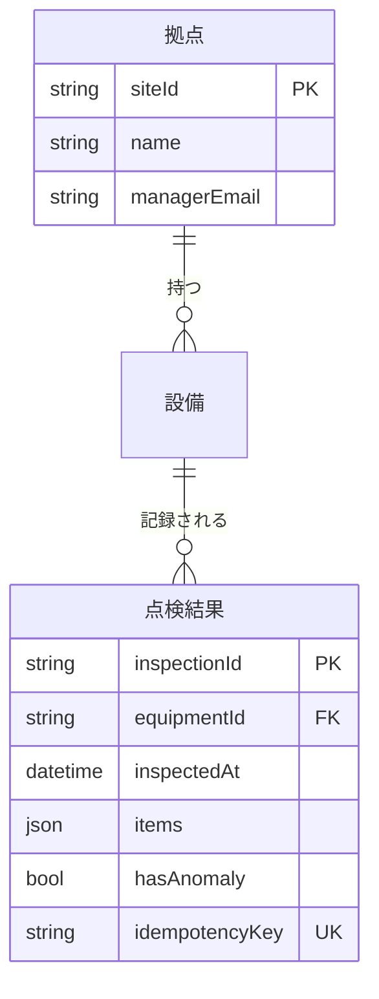

# 契約書　CTR-F-003 点検DB

| 項目 | 内容 |
|---|---|
| 契約ID | CTR-F-003 |
| 契約名 | 点検DB |
| 種別 | 機能契約 |
| 版 | 1 |
| 状態 | 作成中 |
| 提供 | SYS-02 クラウドバックエンド / CMP-0204 点検DB |
| 形式 | ER図 |
| 厚さ | 厚い |
| 作成日 | 2026-10-03 |
| 生成元 | OKF バンドル（（導出）の節は取り込み時に無視される） |

## 1. 契約内容

同一システム内だが、複数コンポーネント（点検API・管理API・異常通知）から使われるため ER 図を持つ。

注：「設備」テーブルは開発オブジェクトとしてまだ起こしていない（サンプルで発見した抜け）。

## 2. 提供コンポーネントの開発オブジェクト（導出）

- OBJ-020401 点検結果テーブル（テーブル）
- OBJ-020402 拠点テーブル（テーブル）

## 3. 突合結果（導出）

- 差異：ER 図の「設備」に対応する開発オブジェクトがない

## 4. 利用者（導出）

| 開発オブジェクト | システム | 参照先 | CRUD | 前提版 | 状態 |
|---|---|---|---|---|---|
| OBJ-020101 点検結果登録API | クラウドバックエンド | OBJ-020401 点検結果テーブル | CR | 1 | 最新 |
| OBJ-020102 点検写真登録API | クラウドバックエンド | OBJ-020401 点検結果テーブル | R | 1 | 最新 |
| OBJ-020201 拠点進捗取得API | クラウドバックエンド | OBJ-020401 点検結果テーブル、OBJ-020402 拠点テーブル | R | 1 | 最新 |
| OBJ-020301 異常通知処理 | クラウドバックエンド | OBJ-020402 拠点テーブル | R | 1 | 最新 |

## 5. 参照する要件（導出）

| 要件 | 参照先 | 前提版 | 状態 |
|---|---|---|---|
| SPC-004 クラウドは受信した点検結果と写真を保存する | OBJ-020401 点検結果テーブル | 1 | 最新 |
| SPC-006 クラウドは異常ありの点検結果を受信したら拠点の管理者へメールで通知する | OBJ-020402 拠点テーブル | 1 | 最新 |

## 6. レビュー

| 確認者 | 確認日時 |
|---|---|
|  |  |

確認観点：

- 突合結果に差異がないか。契約に主従はないため、差異は当事者間の衝突として裁定で解決する
- 利用者の参照先・CRUD が契約内容と矛盾しないか
- 要確認の参照が解消されているか

確認後、確認者と確認日時を記入して取り込むと OKF の verified に反映される。
