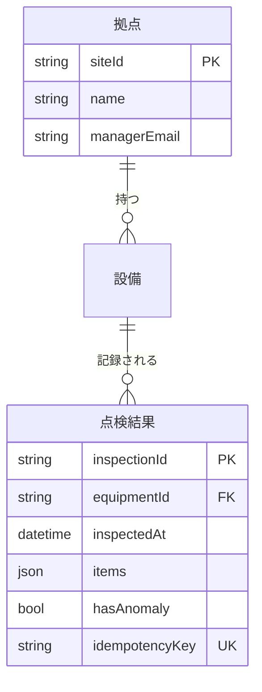

# 機能設計書　SYS-02 クラウドバックエンド

| 種別 | プロダクト | 作成日 |
|---|---|---|
| アプリ | PRD-001 点検ノート | 2026-10-03 |

管理情報：版 1／状態 作成中

凡例：＊印の節は OKF から自動で導出した参考情報で、設計書から OKF への取り込み対象外。トレーサビリティの「直接」は要件が契約で直接指す、「利用」は利用する契約経由、「配分」は非機能の配分、「ユースケース」は要求・要件の補足に登場。

## 1. システム概要

API・DB・写真ストレージ・通知処理。

## 2. 構成

| コンポーネントID | 名称 | 種別 | 説明 | 版 | 状態 |
|---|---|---|---|---|---|
| CMP-0201 | 点検API | API定義 | OpenAPI 1 ファイル。 | 1 | 作成中 |
| CMP-0202 | 管理API | API定義 | OpenAPI 1 ファイル。 | 1 | 作成中 |
| CMP-0203 | 異常通知 | 機能群 | ― | 1 | 作成中 |
| CMP-0204 | 点検DB | データストア | ― | 1 | 作成中 |
| CMP-0205 | 写真ストレージ | ファイル群 | オブジェクトストレージ。 | 1 | 作成中 |

## 3. 機能一覧＊

| 機能ID | 機能名 | 種別 | 操作 | コンポーネント |
|---|---|---|---|---|
| OBJ-020101 | 点検結果登録API | API | POST /inspections | 点検API |
| OBJ-020102 | 点検写真登録API | API | PUT /inspections/{id}/photos/{n} | 点検API |
| OBJ-020201 | 拠点進捗取得API | API | GET /sites/progress | 管理API |
| OBJ-020301 | 異常通知処理 | イベント処理 | ― | 異常通知 |

## 4. 機能詳細

### 4.1 OBJ-020101 点検結果登録API

| 種別 | コンポーネント | 操作 |
|---|---|---|
| API | CMP-0201 点検API | POST /inspections |

#### 4.1.1 概要

点検結果を 1 件受け付けて保存する。異常を含む場合は異常イベントを発行する。

#### 4.1.2 インターフェース＊

出典：CTR-F-001 点検API

**パラメータ**

| 名前 | 位置 | 型 | 必須 |
|---|---|---|---|
| Idempotency-Key | header | string | ○ |

**入力**（application/json）

| 項目 | 型 | 必須 | 備考 |
|---|---|---|---|
| equipmentId | string | ○ |  |
| inspectedAt | string | ○ | date-time |
| items | object の配列 | ○ |  |
| items[].code | string |  |  |
| items[].result | 列挙 |  | 正常／異常 |
| items[].comment | string |  |  |

**出力**

| コード | 内容 |
|---|---|
| 201 | （本文の定義なし） |
| 200 | 冪等キー重複時 |

#### 4.1.3 処理内容

1. Idempotency-Key で点検結果テーブルを検索し、既に存在すれば保存済みの内容を 200 で返す。
2. 入力を検証する（equipmentId の存在、items が 1 件以上）。
3. 点検結果テーブルに登録する。items に「異常」が 1 件でもあれば hasAnomaly = true。
4. hasAnomaly = true の場合、異常イベントを発行する。
5. 201 で inspectionId を返す。

#### 4.1.4 エラー処理

| 条件 | 応答 | メッセージ |
|---|---|---|
| 必須項目なし・形式不正 | 400 | 入力内容に誤りがあります |
| equipmentId が存在しない | 404 | 設備が見つかりません |
| イベント発行失敗 | 201 | （登録は成功扱い。発行は再試行キューへ） |

#### 4.1.5 使用データ

| データ | CRUD | 契約 | 前提版 |
|---|---|---|---|
| OBJ-020401 点検結果テーブル | CR | CTR-F-003 点検DB | 1 |

#### 4.1.6 呼び出し・依存

| 契約 | 相手 | 前提版 |
|---|---|---|
| CTR-F-007 異常イベント | CMP-0203 異常通知（全体） | 1 |
| CTR-F-008 DB接続 | CMP-0402 データ基盤（全体） | 1 |

#### 4.1.7 トレーサビリティ＊

- SPC-003 モバイルアプリは通信回復時に未送信の点検結果と写真を自動送信する（直接）
- SPC-004 クラウドは受信した点検結果と写真を保存する（直接）
- SPC-006 クラウドは異常ありの点検結果を受信したら拠点の管理者へメールで通知する（利用）
- SPC-008 クラウドは異常通知を点検結果の受信から 5 分以内に送信する（配分）
- 非機能 CTR-N-002 異常通知の即時性：受信から異常イベント発行まで 10 秒以内

管理情報：版 1／状態 作成中

### 4.2 OBJ-020102 点検写真登録API

| 種別 | コンポーネント | 操作 |
|---|---|---|
| API | CMP-0201 点検API | PUT /inspections/{id}/photos/{n} |

#### 4.2.1 概要

点検結果に写真を 1 枚追加する。同じ n で再送された場合は上書きする。

#### 4.2.2 インターフェース＊

出典：CTR-F-001 点検API

**入力**：image/jpeg

#### 4.2.3 処理内容

1. 点検結果テーブルに id が存在することを確認する。
2. 画像を検証する（JPEG、長辺 2048px 以下）。
3. 写真ストレージにキー規約どおり保存する。

#### 4.2.4 エラー処理

| 条件 | 応答 | メッセージ |
|---|---|---|
| 点検結果が存在しない | 404 | 点検結果が見つかりません |
| 形式・サイズ不正 | 400 | 写真の形式が不正です |

#### 4.2.5 使用データ

| データ | CRUD | 契約 | 前提版 |
|---|---|---|---|
| OBJ-020401 点検結果テーブル | R | CTR-F-003 点検DB | 1 |
| OBJ-020501 点検写真 | C | CTR-F-006 写真ストレージ | 1 |

#### 4.2.6 呼び出し・依存

| 契約 | 相手 | 前提版 |
|---|---|---|
| CTR-F-008 DB接続 | CMP-0402 データ基盤（全体） | 1 |
| CTR-F-009 写真バケット | CMP-0403 ストレージ基盤（全体） | 1 |

#### 4.2.7 トレーサビリティ＊

- SPC-003 モバイルアプリは通信回復時に未送信の点検結果と写真を自動送信する（直接）
- SPC-004 クラウドは受信した点検結果と写真を保存する（直接）

管理情報：版 1／状態 作成中

### 4.3 OBJ-020201 拠点進捗取得API

| 種別 | コンポーネント | 操作 |
|---|---|---|
| API | CMP-0202 管理API | GET /sites/progress |

#### 4.3.1 概要

指定月の拠点ごとの点検対象数と点検済数を返す。

#### 4.3.2 インターフェース＊

出典：CTR-F-004 管理API

**パラメータ**

| 名前 | 位置 | 型 | 必須 |
|---|---|---|---|
| month | query | string |  |

**出力**

| コード | 内容 |
|---|---|
| 200 | 配列（siteId、name、total、done） |

#### 4.3.3 処理内容

1. month 未指定の場合は当月とする。
2. 拠点ごとに、対象設備数と、当月に点検結果がある設備数を集計する。
3. 拠点名の昇順で返す。

#### 4.3.4 エラー処理

| 条件 | 応答 | メッセージ |
|---|---|---|
| month の形式不正 | 400 | 対象月の形式が不正です |

#### 4.3.5 使用データ

| データ | CRUD | 契約 | 前提版 |
|---|---|---|---|
| OBJ-020401 点検結果テーブル、OBJ-020402 拠点テーブル | R | CTR-F-003 点検DB | 1 |

#### 4.3.6 呼び出し・依存

| 契約 | 相手 | 前提版 |
|---|---|---|
| CTR-F-008 DB接続 | CMP-0402 データ基盤（全体） | 1 |

#### 4.3.7 トレーサビリティ＊

- SPC-005 ダッシュボードは拠点ごとの当月点検完了率を表示する（直接）
- SPC-007 ダッシュボードは拠点進捗を 3 秒以内に表示する（配分）
- 非機能 CTR-N-001 ダッシュボード応答性能：API 応答 1.5 秒以内

管理情報：版 1／状態 作成中

### 4.4 OBJ-020301 異常通知処理

| 種別 | コンポーネント |
|---|---|
| イベント処理 | CMP-0203 異常通知 |

#### 4.4.1 概要

異常イベントを受け、拠点の管理者へメールで通知する。

#### 4.4.2 インターフェース＊

受信するメッセージ（出典：CTR-F-007 異常イベント）

```json
{ "inspectionId": "string", "siteId": "string", "equipmentId": "string", "anomalyItems": ["code"] }
```

#### 4.4.3 処理内容

1. 異常イベントを受信する。
2. 拠点テーブルから siteId の管理者メールアドレスを取得する。
3. 件名「【点検ノート】異常検知：{設備名}」で、異常項目とダッシュボードの URL を本文に含めて送信 API を呼ぶ。

#### 4.4.4 エラー処理

| 条件 | 対応 |
|---|---|
| 管理者メール未登録 | ログに警告を出して終了 |
| 送信 API が 5xx・タイムアウト | 指数バックオフで最大 3 回再試行。失敗したらデッドレターへ |

#### 4.4.5 使用データ

| データ | CRUD | 契約 | 前提版 |
|---|---|---|---|
| OBJ-020402 拠点テーブル | R | CTR-F-003 点検DB | 1 |

#### 4.4.6 呼び出し・依存

| 契約 | 相手 | 前提版 |
|---|---|---|
| CTR-F-005 メール送信 | CMP-0501 メール送信API（全体） | 1 |
| CTR-F-008 DB接続 | CMP-0402 データ基盤（全体） | 1 |

#### 4.4.7 トレーサビリティ＊

- SPC-006 クラウドは異常ありの点検結果を受信したら拠点の管理者へメールで通知する（直接）
- SPC-008 クラウドは異常通知を点検結果の受信から 5 分以内に送信する（配分）
- 非機能 CTR-N-002 異常通知の即時性：イベント受信から送信 API 呼び出しまで 1 分以内（リトライ込み）

管理情報：版 1／状態 作成中

## 5. データ詳細

### 5.1 OBJ-020401 点検結果テーブル

| 種別 | コンポーネント |
|---|---|
| テーブル | CMP-0204 点検DB |

#### 5.1.1 インターフェース＊

受信するメッセージ（出典：CTR-F-003 点検DB）



#### 5.1.2 項目定義＊

出典：CTR-F-003 点検DB の ER 図

| 項目 | 型 | キー |
|---|---|---|
| inspectionId | string | PK |
| equipmentId | string | FK |
| inspectedAt | datetime |  |
| items | json |  |
| hasAnomaly | bool |  |
| idempotencyKey | string | UK |

管理情報：版 1／状態 作成中

### 5.2 OBJ-020402 拠点テーブル

| 種別 | コンポーネント |
|---|---|
| テーブル | CMP-0204 点検DB |

#### 5.2.1 概要

管理者のメールアドレスを含む。

#### 5.2.2 インターフェース＊

受信するメッセージ（出典：CTR-F-003 点検DB）


#### 5.2.3 項目定義＊

出典：CTR-F-003 点検DB の ER 図

| 項目 | 型 | キー |
|---|---|---|
| siteId | string | PK |
| name | string |  |
| managerEmail | string |  |

管理情報：版 1／状態 作成中

### 5.3 OBJ-020501 点検写真

| 種別 | コンポーネント |
|---|---|
| ファイル | CMP-0205 写真ストレージ |

管理情報：版 1／状態 作成中

## 6. CRUD 図＊

| 機能 ＼ データ | 点検結果テーブル | 点検写真 | 拠点テーブル |
|---|---|---|---|
| 点検結果登録API | CR |  |  |
| 点検写真登録API | R | C |  |
| 拠点進捗取得API | R |  | R |
| 異常通知処理 |  |  | R |

## 7. 外部インターフェース＊

| 方向 | 契約 | 相手 |
|---|---|---|
| 利用 | CTR-F-005 メール送信 | 外部メール配信サービス（異常通知処理 から） |
| 利用 | CTR-F-008 DB接続 | クラウド基盤（拠点進捗取得API から）<br>クラウド基盤（点検写真登録API から）<br>クラウド基盤（点検結果登録API から）<br>クラウド基盤（異常通知処理 から） |
| 利用 | CTR-F-009 写真バケット | クラウド基盤（点検写真登録API から） |
| 提供 | CTR-F-001 点検API | モバイルアプリ（同期処理） |
| 提供 | CTR-F-004 管理API | 管理ダッシュボード（拠点進捗画面） |

## 8. 非機能要件＊

**CTR-N-001 ダッシュボード応答性能**（目標：拠点進捗の表示 3 秒以内（p95））

- CMP-0202 管理API（全体）：API 応答 1.5 秒以内
- OBJ-020401 点検結果テーブル、OBJ-020402 拠点テーブル：集計クエリ 0.5 秒以内

**CTR-N-002 異常通知の即時性**（目標：点検結果受信から送信 API 受付まで 5 分以内）

- OBJ-020101 点検結果登録API：受信から異常イベント発行まで 10 秒以内
- CMP-0203 異常通知（全体）：イベント受信から送信 API 呼び出しまで 1 分以内（リトライ込み）

## 9. 未記載・確認事項＊

本書で記入する節：

| 機能・データ | 概要 | 認証 | 起動条件 | 保持 |
|---|---|---|---|---|
| OBJ-020101 点検結果登録API |  | 未 |  |  |
| OBJ-020102 点検写真登録API |  | 未 |  |  |
| OBJ-020201 拠点進捗取得API |  | 未 |  |  |
| OBJ-020301 異常通知処理 |  |  | 未 |  |
| OBJ-020401 点検結果テーブル | 未 |  |  | 未 |
| OBJ-020402 拠点テーブル |  |  |  | 未 |
| OBJ-020501 点検写真 | 未 |  |  | 未 |

その他：

- OBJ-020402 拠点テーブル を登録・更新する機能がない（要件の抜けの可能性）
