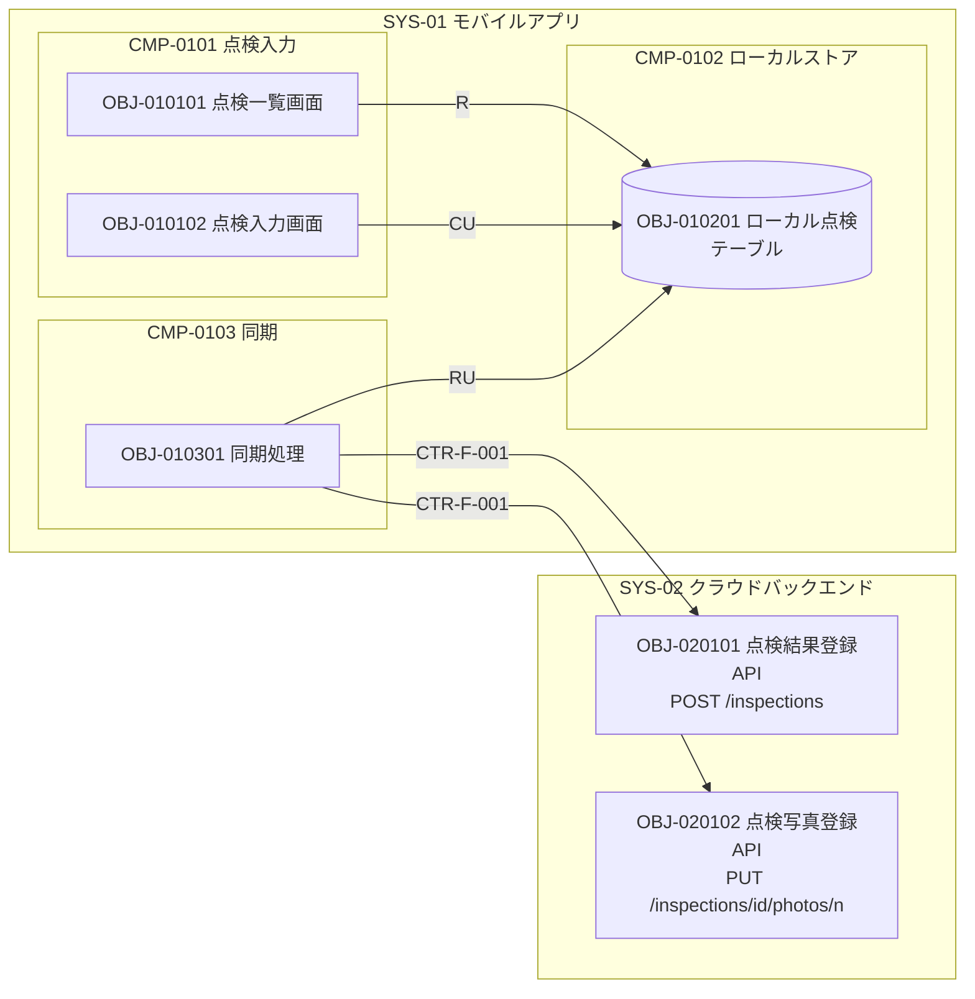
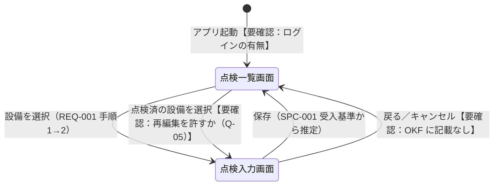

# 機能設計書　SYS-01 モバイルアプリ

## 表紙

| 項目 | 内容 |
|---|---|
| 文書名 | 機能設計書（SYS-01 モバイルアプリ） |
| プロダクト | PRD-001 点検ノート |
| システム | SYS-01 モバイルアプリ（種別：アプリ） |
| 文書番号 | 【要確認：文書番号の採番規則が OKF にない】 |
| 版 | 第 1 版（OKF：SYS-01 revision 1） |
| 状態 | 作成中（OKF：status draft） |
| 作成日 | 2026-10-03（OKF log.md「サンプル初版作成」の日付） |
| 作成者 | 【要確認：作成者・承認者が OKF にない】 |
| 承認者 | 【要確認】 |

本書は OKF バンドル `samples/tenken-note/` を正本として、設計者が手で作成した。OKF に記載がない事項は「【要確認：…】」と記す。

## 改版履歴

| 版 | 日付 | 改版内容 | 根拠（OKF） | 作成者 |
|---|---|---|---|---|
| 1 | 2026-10-03 | 初版作成 | log.md 2026-10-03「サンプル初版作成」、SYS-01／CMP-01xx／OBJ-01xxxx すべて revision 1 | 【要確認】 |

---

## 1. 概要

### 1.1 目的

現場の設備点検を紙からスマートフォンへ移し、点検者が点検項目の結果と写真を記録できるようにする（REQ-001）。電波の届かない場所でも記録でき、通信回復後に事務所（クラウド）と共有できるようにする（REQ-002）。端末を紛失しても点検データが第三者に読まれないようにする（REQ-006）。

背景（RUL-001 #1, #3, #9）：点検は紙で行い、事務所で毎回エクセルに転記している。地下の機械室など電波が届かない場所が多い。

### 1.2 範囲

本書の対象は SYS-01 モバイルアプリ（iOS / Android）の以下とする。

| 区分 | 対象 |
|---|---|
| 画面 | OBJ-010101 点検一覧画面、OBJ-010102 点検入力画面 |
| バックグラウンド処理 | OBJ-010301 同期処理 |
| 端末内テーブル | OBJ-010201 ローカル点検テーブル |

対象外：
- クラウド側の API・DB・写真ストレージ・異常通知（SYS-02 の機能設計書で扱う）。本書では CTR-F-001 点検API の利用側としてのみ記す。
- ログイン・認証（SPC-001 の受入基準は「点検者がログイン済み」を前提とするが、OKF に認証の開発オブジェクト・契約がない。docs/open-issues.md #22）。【要確認：ログイン画面・認証処理を SYS-01 の範囲に含めるか】
- 点検対象設備・点検項目マスタの端末への取り込み。【要確認：後述 10 章 Q-01】

### 1.3 前提・制約

| No | 前提・制約 | 出典 |
|---|---|---|
| 1 | 対象 OS は iOS / Android | SYS-01 本文 |
| 2 | 利用者は点検者 | SYS-01 本文、REQ-001／REQ-002 の主語 |
| 3 | 圏外でも点検を記録できる。記録は端末内に保持し、通信回復時に利用者の操作なしで自動送信する | SPC-002、SPC-003 |
| 4 | 点検データは端末内で暗号化する | CTR-N-004（CMP-0102 への配分） |
| 5 | 点検者はログイン済みであることを前提とする | SPC-001 受入基準（前提） |
| 6 | 対象 OS の最低バージョン・対応端末 | 【要確認：OKF にない】 |
| 7 | 開発言語・フレームワーク・端末内 DB の製品 | 【要確認：OKF にない。候補：ネイティブ（Swift/Kotlin）、クロスプラットフォーム（Flutter / React Native）、端末内 DB は SQLite＋暗号化拡張 等】 |
| 8 | 配布方法（ストア配布／MDM 配布） | 【要確認：OKF にない】 |

### 1.4 用語

| 用語 | 意味 | 出典 |
|---|---|---|
| 点検者 | 現場で設備点検を行う利用者 | REQ-001 |
| 点検結果 | 1 設備に対する 1 回の点検の記録（点検項目ごとの結果・コメント、写真） | CTR-F-001 |
| 点検項目 | 点検結果を構成する項目。code・result（正常／異常）・comment を持つ | CTR-F-001 |
| 未送信／送信済 | 端末内の点検結果のクラウドへの送信状態 | CTR-F-002 sendState |
| 冪等キー | 同じ点検結果の重複登録を防ぐためのキー（Idempotency-Key ヘッダ） | CTR-F-001、CTR-F-002 |

---

## 2. 構成

### 2.1 コンポーネント構成

| コンポーネントID | 名称 | 種別 | 説明 | 版 |
|---|---|---|---|---|
| CMP-0101 | 点検入力 | 機能群 | 【要確認：OKF 本文が見出しのみ】 | 1 |
| CMP-0102 | ローカルストア | データストア | 端末内 DB | 1 |
| CMP-0103 | 同期 | 機能群 | 【要確認：OKF 本文が見出しのみ】 | 1 |

### 2.2 構成図



補足：
- 画面・同期処理 → ローカル点検テーブルの線は CTR-F-002（同一システム内の薄い契約）による。
- 同期処理 → クラウドの線は CTR-F-001（システム間の厚い契約）による。
- 同期処理が送信済に更新したことを点検一覧画面に知らせる仕組み（画面の自動更新）は OKF にリレーションがない。【要確認：Q-08】

---

## 3. 機能一覧

### 3.1 機能一覧

| 機能ID | 機能名 | 種別 | コンポーネント | 概要 | 関連要件 |
|---|---|---|---|---|---|
| OBJ-010101 | 点検一覧画面 | 画面 | CMP-0101 | 当月の点検対象設備の一覧と送信状態を表示し、点検する設備を選ぶ | SPC-001, SPC-002, SPC-003（受入基準の表示条件） |
| OBJ-010102 | 点検入力画面 | 画面 | CMP-0101 | 点検項目の結果・コメントを入力し、写真を撮影して端末内に保存する | SPC-001, SPC-002 |
| OBJ-010301 | 同期処理 | バックグラウンド処理 | CMP-0103 | 通信回復時に未送信の点検結果と写真をクラウドへ自動送信する | SPC-003（SPC-004 は送信先側） |
| OBJ-010201 | ローカル点検テーブル | テーブル（端末内） | CMP-0102 | 点検結果を端末内に保持する | SPC-001, SPC-002, SPC-003 |

注：「概要」列は OKF の開発オブジェクト本文が空のため、要求のユースケースと要件のタイトルから設計者がまとめた。【要確認：各 OBJ の概要を OKF 本文に記載すること】

### 3.2 画面一覧

| 画面ID | 画面名 | 利用者 | 起動元 | 主な用途 | ユースケース（出典） |
|---|---|---|---|---|---|
| OBJ-010101 | 点検一覧画面 | 点検者 | 【要確認：アプリ起動直後の画面か、ログイン後の画面か】 | 対象設備を選ぶ／未送信件数・送信状態を確認する | REQ-001 手順1、REQ-002 手順2・3 |
| OBJ-010102 | 点検入力画面 | 点検者 | 点検一覧画面で設備を選択 | 点検項目の入力・写真撮影・保存 | REQ-001 手順2、REQ-002 手順1 |

### 3.3 画面遷移図

OKF に画面遷移の定義はない。以下は要求のユースケースの手順の並び（REQ-001：一覧から選ぶ → 入力・保存）と SPC-001 の受入基準（保存後、点検一覧で「点検済（未送信）」と表示される）から推定した遷移であり、【要確認：画面遷移の正本をどこに持つか（Q-09）】。



| 遷移元 | 契機 | 遷移先 | 根拠 |
|---|---|---|---|
| （起動） | アプリ起動 | 点検一覧画面 | 【要確認：起動画面・ログイン画面の有無】 |
| 点検一覧画面 | 設備を選択 | 点検入力画面 | REQ-001 ユースケースの手順順序（推定） |
| 点検入力画面 | 保存 | 点検一覧画面 | SPC-001 受入基準（推定） |
| 点検入力画面 | 戻る・キャンセル | 点検一覧画面 | 【要確認：未保存入力の破棄確認の要否】 |
| ― | カメラ起動・撮影 | OS のカメラ画面（または アプリ内カメラ） | 【要確認：OS 標準カメラかアプリ内カメラか】 |

---

## 4. 機能詳細

### 4.1 OBJ-010101 点検一覧画面

| 項目 | 内容 |
|---|---|
| 画面ID | OBJ-010101 |
| 画面名 | 点検一覧画面 |
| コンポーネント | CMP-0101 点検入力 |
| 版 | 1 |
| 使用データ | OBJ-010201 ローカル点検テーブル（R、CTR-F-002 r1） |

#### 4.1.1 概要

点検者が当月の点検対象設備を一覧から選ぶ（REQ-001 手順1）。各設備の点検状態（点検済（未送信）／送信済）と、未送信の件数を確認できる（REQ-002 手順2・3、SPC-001・SPC-003 受入基準）。

【要確認：OKF の OBJ-010101 本文は見出しのみ。概要はユースケースから設計者が書き起こした】

#### 4.1.2 画面レイアウト

```
┌──────────────────────────────┐
│ （画面レイアウトは別途作成）           │
│  ・ヘッダ：画面タイトル【要確認】      │
│  ・未送信件数                          │
│  ・点検対象設備の一覧（行選択）        │
└──────────────────────────────┘
```

【要確認：レイアウト画像・ワイヤーフレームの所在が OKF にない】

#### 4.1.3 画面項目

| No | 項目名 | 種類 | 入出力 | 必須 | 桁 | 初期値 | 説明 |
|---|---|---|---|---|---|---|---|
| 1 | 対象月 | 表示 | 出力 | ― | 【要確認】 | 当月 | 「当月の点検対象設備」（REQ-001）の当月。表示するか自体【要確認】 |
| 2 | 未送信件数 | 表示 | 出力 | ― | 【要確認】 | ― | sendState＝未送信 の件数（REQ-002 手順2）。対象を当月に限るか全件か【要確認】 |
| 3 | 設備一覧 | 一覧 | 出力 | ― | ― | ― | 当月の点検対象設備。**データの取得元が OKF にない**【要確認：Q-01】。並び順【要確認】 |
| 3-1 | 設備ID | 表示 | 出力 | ― | 【要確認】 | ― | equipmentId（CTR-F-002）。画面に表示するか【要確認】 |
| 3-2 | 設備名 | 表示 | 出力 | ― | 【要確認】 | ― | 【要確認：設備名は CTR-F-002・CTR-F-001 にない。CTR-F-003 ER 図の「設備」エンティティにも属性の記載がない】 |
| 3-3 | 点検状態 | 表示 | 出力 | ― | ― | ― | 未点検（推定）／点検済（未送信）／送信済。表示文言は SPC-001・REQ-002 による。「未点検」は OKF に文言がない【要確認】 |
| 4 | 再送信（手動同期） | ボタン | 入力 | ― | ― | ― | 【要確認：手動送信手段を設けるか。SPC-003 は「利用者の操作なしに」送信とするのみ】 |

#### 4.1.4 操作・イベント

| No | 契機 | 処理 | 出典 |
|---|---|---|---|
| 1 | 画面表示時 | ローカル点検テーブルを読み、設備ごとの点検状態と未送信件数を表示する | OBJ-010101 uses（R）、REQ-002 |
| 2 | 設備行の選択 | 点検入力画面へ遷移する。選択した equipmentId を渡す | REQ-001（推定） |
| 3 | 同期処理による送信状態の変更 | 一覧の表示を「送信済」に更新する | REQ-002 手順3、SPC-003。【要確認：画面の自動更新の方式（DB 変更監視／イベント通知／画面復帰時の再読込）】 |
| 4 | 点検済の設備を選択 | 【要確認：再編集可／閲覧のみ／選択不可（Q-05）】 | ― |

#### 4.1.5 画面遷移

3.3 を参照。

#### 4.1.6 入力チェック

入力項目なし（一覧の選択のみ）。【要確認：送信済の設備や対象外の設備の選択可否】

#### 4.1.7 メッセージ

| No | 条件 | メッセージ | 種別 |
|---|---|---|---|
| 1 | 当月の対象設備が 0 件 | 【要確認：OKF にない】 | 情報 |
| 2 | ローカル点検テーブルの読込失敗 | 【要確認：OKF にない】 | エラー |

#### 4.1.8 権限

| 利用者 | 可否 | 根拠 |
|---|---|---|
| 点検者 | 利用可 | REQ-001、REQ-002 の主語 |
| その他 | 【要確認：点検者の担当拠点・担当設備で一覧を絞り込むか。OKF に点検者と拠点・設備の割当がない】 | ― |

---

### 4.2 OBJ-010102 点検入力画面

| 項目 | 内容 |
|---|---|
| 画面ID | OBJ-010102 |
| 画面名 | 点検入力画面 |
| コンポーネント | CMP-0101 点検入力 |
| 版 | 1 |
| 使用データ | OBJ-010201 ローカル点検テーブル（CU、CTR-F-002 r1） |

#### 4.2.1 概要

選んだ設備について、各点検項目に「正常／異常」とコメントを入力し、写真を撮影して端末内に保存する（REQ-001 手順2、SPC-001）。圏外でも保存できる（REQ-002 手順1、SPC-002）。保存した点検結果は「未送信」として端末内に残り、同期処理が送信する。

【要確認：OKF の OBJ-010102 本文は見出しのみ】

#### 4.2.2 画面レイアウト

```
┌──────────────────────────────┐
│ （画面レイアウトは別途作成）           │
│  ・設備情報                            │
│  ・点検項目の繰り返し                  │
│     結果（正常／異常）・コメント       │
│  ・写真（撮影ボタン・サムネイル）      │
│  ・保存ボタン                          │
└──────────────────────────────┘
```

#### 4.2.3 画面項目

| No | 項目名 | 種類 | 入出力 | 必須 | 桁 | 初期値 | 説明 |
|---|---|---|---|---|---|---|---|
| 1 | 設備ID | 表示 | 出力 | ― | 【要確認】 | 一覧で選択した設備 | equipmentId（CTR-F-001 必須、CTR-F-002） |
| 2 | 設備名 | 表示 | 出力 | ― | 【要確認】 | ― | 【要確認：データの取得元がない（Q-01）】 |
| 3 | 点検日時 | 表示または入力 | 【要確認】 | ○（API 上必須） | ― | 【要確認：候補＝保存時刻／入力開始時刻／利用者入力】 | inspectedAt（CTR-F-001 で必須、date-time）。**CTR-F-002 に項目がない**（Q-03） |
| 4 | 点検項目一覧 | 繰り返し | ― | ○（API 側で 1 件以上。OBJ-020101） | ― | 【要確認】 | 設備ごとの点検項目の定義（何を点検するか）が OKF にない（Q-02） |
| 4-1 | 項目コード | 表示（非表示保持） | 出力 | ○ | 【要確認】 | 点検項目マスタ【要確認】 | items[].code（CTR-F-001） |
| 4-2 | 項目名 | 表示 | 出力 | ― | 【要確認】 | ― | 【要確認：項目名の定義がない】 |
| 4-3 | 結果 | 選択（ラジオ等）【要確認】 | 入力 | 【要確認：各項目必須か】 | ― | 【要確認：未選択／正常】 | items[].result。値は「正常」「異常」（CTR-F-001 enum、SPC-001） |
| 4-4 | コメント | テキスト | 入力 | 【要確認：任意か、異常時のみ必須か】 | 【要確認】 | 空 | items[].comment（CTR-F-001） |
| 5 | 写真 | 撮影ボタン＋サムネイル | 入力 | 【要確認：SPC-001 受入基準は「1 枚以上撮影して保存」。必須かどうか不明】 | 枚数上限【要確認】 | なし | photos（CTR-F-002：パス）。送信時は JPEG・長辺 2048px 以下（CTR-F-006／OBJ-020102）。端末側で縮小するか【要確認】 |
| 6 | 保存 | ボタン | 入力 | ― | ― | ― | ローカル点検テーブルへ登録・更新する |
| 7 | 戻る | ボタン | 入力 | ― | ― | ― | 【要確認：OKF に記載なし】 |

#### 4.2.4 操作・イベント

| No | 契機 | 処理 | 出典 |
|---|---|---|---|
| 1 | 画面表示時 | 選択された設備の点検項目を表示する。既存のローカル点検があれば読み込む【要確認：uses の CRUD に R がない（CU のみ）が、U には既存行の読込が必要】 | OBJ-010102 uses（CU） |
| 2 | 撮影ボタン押下 | カメラで撮影し、写真を端末内に保存してパスを保持する | SPC-001。【要確認：写真ファイルの保存場所と暗号化（Q-07）】 |
| 3 | 写真の削除 | 【要確認：撮影済み写真の削除・撮り直しを許すか】 | ― |
| 4 | 保存ボタン押下 | 入力チェック後、ローカル点検テーブルに登録（新規）または更新する。sendState＝未送信。idempotencyKey を設定する【要確認：冪等キーの生成時期と方式（候補：新規登録時に UUID を生成）】。保存後、点検一覧画面へ戻る | SPC-001、SPC-002、CTR-F-002 |
| 5 | 送信済の点検の再保存 | 【要確認：CTR-F-001 に更新 API がないため、送信済の修正をクラウドへ反映する手段がない（Q-05）】 | ― |

#### 4.2.5 画面遷移

3.3 を参照。

#### 4.2.6 入力チェック

| No | 対象 | チェック内容 | 根拠 |
|---|---|---|---|
| 1 | 点検項目 | 1 件以上あること | OBJ-020101 処理2（API 側の検証）。端末側でも同じ検証をするか【要確認】 |
| 2 | 結果 | 「正常」「異常」のいずれか | CTR-F-001 enum |
| 3 | 結果 | 全項目入力済みであること | 【要確認：OKF にない】 |
| 4 | コメント | 桁数上限・異常時必須 | 【要確認：OKF にない】 |
| 5 | 写真 | 1 枚以上 | 【要確認：SPC-001 受入基準の操作に「1 枚以上撮影」とあるが、必須チェックかどうか不明】 |
| 6 | 写真 | 枚数上限 | 【要確認：PUT の n の範囲が CTR-F-001 にない】 |

#### 4.2.7 メッセージ

| No | 条件 | メッセージ | 種別 |
|---|---|---|---|
| 1 | 保存完了 | 【要確認：OKF にない】 | 情報 |
| 2 | 入力チェックエラー | 【要確認：OKF にない。参考：API 側は「入力内容に誤りがあります」（OBJ-020101）】 | エラー |
| 3 | 端末の保存失敗（容量不足等） | 【要確認：OKF にない】 | エラー |
| 4 | カメラ権限なし | 【要確認：OKF にない】 | 警告 |
| 5 | 未保存で戻る | 【要確認：破棄確認を出すか】 | 確認 |

#### 4.2.8 権限

| 利用者 | 可否 | 根拠 |
|---|---|---|
| 点検者 | 入力・保存可 | REQ-001 の主語 |
| ― | 【要確認：他の点検者が保存した点検を編集できるか（1 端末を複数人で共用するか）。OKF に端末と利用者の関係がない】 | ― |

端末 OS の権限：カメラ（SPC-001 の撮影）。【要確認：写真ライブラリからの選択を許すか、位置情報を記録するか】

---

### 4.3 OBJ-010301 同期処理

| 項目 | 内容 |
|---|---|
| 処理ID | OBJ-010301 |
| 処理名 | 同期処理 |
| 種別 | バックグラウンド処理 |
| コンポーネント | CMP-0103 同期 |
| 版 | 1 |
| 使用データ | OBJ-010201 ローカル点検テーブル（RU、CTR-F-002 r1） |
| 呼び出す API | OBJ-020101 POST /inspections、OBJ-020102 PUT /inspections/{id}/photos/{n}（CTR-F-001 r1） |

#### 4.3.1 概要

通信回復時に、端末内の未送信の点検結果と写真を、利用者の操作なしにクラウドへ送信する（SPC-003）。送信途中で圏外になっても、再度回復したときに重複なく送信する（SPC-003 受入基準）。

【要確認：OKF の OBJ-010301 本文は見出しのみ】

#### 4.3.2 起動契機

| No | 契機 | 根拠 |
|---|---|---|
| 1 | 通信回復（オフライン → オンライン） | SPC-003 タイトル・受入基準「機内モードを解除する」 |
| 2 | 点検結果の保存直後（オンライン時） | 【要確認：OKF にない】 |
| 3 | アプリ起動時・フォアグラウンド復帰時 | 【要確認：OKF にない】 |
| 4 | 定期実行 | 【要確認：OKF にない。OS のバックグラウンド実行制限（iOS BGTaskScheduler／Android WorkManager）でアプリ非起動時にも送るか】 |

#### 4.3.3 入力

| 入力 | 内容 |
|---|---|
| ローカル点検テーブル | sendState＝未送信 の行（equipmentId、items、photos、idempotencyKey） |
| 写真ファイル | photos のパスが指す画像 |

#### 4.3.4 処理

以下は CTR-F-001・OBJ-020101・OBJ-020102 から組み立てた手順で、OKF の OBJ-010301 本文には記載がない。【要確認：手順の正本を OBJ-010301 本文に書くこと】

1. ローカル点検テーブルから sendState＝未送信 の行を読む。処理順【要確認：候補＝保存の古い順】。
2. 行ごとに POST /inspections を呼ぶ。ヘッダ Idempotency-Key＝idempotencyKey。本文は equipmentId・inspectedAt・items。
   - inspectedAt はローカル点検テーブルにない【要確認：Q-03】。
3. 応答 201（新規）または 200（冪等キー重複）で inspectionId を受け取る。
   - CTR-F-001 の 201／200 の応答本文の定義がない。OBJ-020101 本文は「201 で inspectionId を返す」「200 で保存済みの内容を返す」とする【要確認：Q-04】。
   - inspectionId を保持する列がローカル点検テーブルにない【要確認：Q-04】。
4. 写真 1 枚ごとに PUT /inspections/{inspectionId}/photos/{n} を呼ぶ（image/jpeg）。n の採番【要確認：候補＝1 始まりの撮影順】。同じ n の再送は上書きされる（OBJ-020102）。
5. 点検結果と全写真の送信が成功したら sendState を「送信済」に更新する。
   - POST 成功・写真の一部失敗の中間状態を sendState（未送信／送信済の 2 値）で表せない【要確認：Q-06】。

#### 4.3.5 再試行・冪等性

| 観点 | 内容 | 根拠 |
|---|---|---|
| 点検結果の冪等性 | 同じ idempotencyKey で再送すれば 1 件だけ登録され、2 回目も成功応答（200）が返る | CTR-F-001、SPC-004 受入基準 |
| 写真の冪等性 | 同じ n の再送は上書き | OBJ-020102 |
| 再試行の契機 | 次回の起動契機（通信回復等）で未送信の行を再送する | SPC-003 受入基準（推定） |
| 再試行回数・間隔 | 【要確認：OKF にない。候補：指数バックオフ】 | ― |
| 4xx 応答時 | 【要確認：400（入力不正）・404（設備なし）の行を未送信のまま再送し続けるか、エラー状態にして利用者に知らせるか。sendState に該当値がない】 | OBJ-020101 エラー表 |
| 写真 404（点検結果なし） | 【要確認：OKF にない】 | OBJ-020102 エラー表 |

#### 4.3.6 多重度・排他

| 観点 | 内容 |
|---|---|
| 同期処理の多重起動 | 【要確認：OKF にない。候補：同時に 1 本のみ（実行中の起動契機は無視）】 |
| 画面との排他 | 点検入力画面（CU）と同期処理（RU）が同じ行を更新しうる。送信中に再編集された場合の扱い【要確認】 |
| 並列送信 | 【要確認：行ごと・写真ごとの並列数】 |

#### 4.3.7 エラー

| 条件 | 対応 |
|---|---|
| 通信不可・タイムアウト | 未送信のまま残し、次の起動契機で再送する（SPC-003 から推定）。タイムアウト値【要確認】 |
| 5xx | 【要確認】 |
| 400／404 | 【要確認：4.3.5 参照】 |
| 写真ファイルが端末にない | 【要確認】 |
| 認証エラー（401／403） | 【要確認：認証が OKF にない（Q-10）】 |

#### 4.3.8 ログ

【要確認：端末内ログ・クラッシュレポート・送信結果の記録の要否と保持期間が OKF にない。個人情報・点検データをログに出さない方針も含めて確認が必要】

#### 4.3.9 利用者への通知

【要確認：送信失敗を利用者に通知するか（OS 通知／一覧での表示）。OKF は一覧の「未送信」「送信済」表示のみ】

---

## 5. データ設計

### 5.1 OBJ-010201 ローカル点検テーブル

| 項目 | 内容 |
|---|---|
| テーブルID | OBJ-010201 |
| テーブル名 | ローカル点検テーブル（CTR-F-002 上の名称：ローカル点検） |
| コンポーネント | CMP-0102 ローカルストア（端末内 DB） |
| 版 | 1 |
| 契約 | CTR-F-002 ローカルストア（r1、薄い契約：テーブル名と主要項目のみ） |
| 暗号化 | 端末内 DB を暗号化する（CTR-N-004 配分）。方式・鍵管理【要確認】 |

#### 5.1.1 項目定義

CTR-F-002 の「主要項目」をもとにする。型・桁・必須は OKF にないため、すべて【要確認】とし候補を併記する。

| No | 項目名（物理） | 論理名 | 型 | 桁 | 必須 | 初期値 | 説明 | 対応する API 項目 |
|---|---|---|---|---|---|---|---|---|
| 1 | localId | ローカルID | 【要確認：候補 UUID 文字列／整数連番】 | 【要確認】 | ○（推定） | 【要確認】 | 端末内の点検結果の識別子 | ― |
| 2 | equipmentId | 設備ID | 【要確認：候補 文字列】 | 【要確認】 | ○（API で必須） | ― | 点検した設備 | equipmentId |
| 3 | items | 点検項目 | 【要確認：候補 JSON 文字列】 | ― | ○（API で必須） | ― | code・result・comment の配列 | items |
| 4 | photos | 写真 | 【要確認：候補 JSON 配列（パスの並び）】 | ― | 【要確認】 | 空 | 写真ファイルのパス | PUT の本文（画像） |
| 5 | sendState | 送信状態 | 【要確認：候補 文字列／列挙】 | ― | ○（推定） | 未送信（推定） | 未送信／送信済 | ― |
| 6 | idempotencyKey | 冪等キー | 【要確認：候補 UUID 文字列】 | 【要確認】 | ○（API で必須） | 【要確認：生成時期】 | POST の Idempotency-Key | Idempotency-Key |
| ― | （不足）inspectedAt | 点検日時 | ― | ― | ― | ― | **CTR-F-001 で必須だがテーブルにない**【要確認：Q-03】 | inspectedAt |
| ― | （不足）inspectionId | サーバ側点検ID | ― | ― | ― | ― | **写真 PUT に必要だがテーブルにない**【要確認：Q-04】 | {id} |
| ― | （不足）作成日時・更新日時 | ― | ― | ― | ― | ― | 送信順・保持期間の判定に必要【要確認】 | ― |
| ― | （不足）点検者 | ― | ― | ― | ― | ― | 端末共用時・監査用【要確認】 | ― |

注：CTR-F-002 は「主要項目のみ」と明記しており、全項目の定義が OKF のどこにもない。

#### 5.1.2 キー・索引

| 種別 | 項目 | 根拠 |
|---|---|---|
| 主キー | localId | 【要確認：名称からの推定。OKF に PK の指定なし】 |
| 一意キー | idempotencyKey | 【要確認：推定】 |
| 索引 | sendState、equipmentId | 【要確認：一覧表示・同期処理の検索条件から推定】 |
| 1 設備・1 か月に複数行 | 【要確認：同じ設備を当月に 2 回点検できるか】 | ― |

#### 5.1.3 保持期間・削除

【要確認：送信済の行と写真ファイルをいつ削除するか OKF にない。どの OBJ にも CRUD の D がない。候補：送信済から N 日後に削除／当月分のみ保持／ログアウト時に削除】

#### 5.1.4 CRUD 図

| 機能 ＼ データ | ローカル点検テーブル | 写真ファイル（端末内） |
|---|---|---|
| OBJ-010101 点検一覧画面 | R | ― |
| OBJ-010102 点検入力画面 | CU（既存行の読込に R も必要：Q-05） | C（【要確認：OKF に写真ファイルの OBJ がない】） |
| OBJ-010301 同期処理 | RU | R |

### 5.2 端末内のその他のデータ

| データ | 用途 | 状況 |
|---|---|---|
| 点検対象設備（当月） | 点検一覧画面の一覧 | 【要確認：OBJ・契約なし（Q-01）】 |
| 点検項目定義 | 点検入力画面の項目 | 【要確認：OBJ・契約なし（Q-02）】 |
| 写真ファイル | 撮影した写真 | 【要確認：OBJ なし。CTR-F-002 にパスのみ】 |
| 認証情報（トークン等） | API 呼び出し | 【要確認：Q-10】 |

---

## 6. インターフェース一覧

| IF-No | 方向 | 相手 | 契約 | オペレーション | 利用する開発オブジェクト | 備考 |
|---|---|---|---|---|---|---|
| IF-01 | 送信 | SYS-02 OBJ-020101 点検結果登録API | CTR-F-001 点検API（r1、OpenAPI） | POST /inspections | OBJ-010301 | Idempotency-Key 必須。応答 201／200（冪等キー重複） |
| IF-02 | 送信 | SYS-02 OBJ-020102 点検写真登録API | CTR-F-001 点検API（r1） | PUT /inspections/{id}/photos/{n} | OBJ-010301 | image/jpeg。JPEG・長辺 2048px 以下（OBJ-020102） |
| IF-03 | 内部 | OBJ-010201 ローカル点検テーブル | CTR-F-002 ローカルストア（r1、薄い） | 読込・登録・更新 | OBJ-010101／010102／010301 | ― |
| IF-04 | 受信 | 設備・点検項目マスタの取得 | 【要確認：契約なし】 | 【要確認】 | 【要確認】 | Q-01、Q-02 |
| IF-05 | 送受信 | 認証 | 【要確認：契約なし】 | 【要確認】 | 【要確認】 | Q-10 |

IF-01／IF-02 の共通事項で OKF にないもの：
- 接続先 URL（サーバ）・環境ごとの切替【要確認】（CTR-F-001 に servers がない。open-issues #28）
- 認証方式（ヘッダ）【要確認】
- タイムアウト値【要確認】
- 4xx／5xx の応答本文の形式【要確認】（エラーメッセージは OBJ-020101／020102 本文にのみあり、CTR-F-001 にはない）

---

## 7. メッセージ一覧

OKF の SYS-01 側の開発オブジェクトにはメッセージの記載が 1 件もない。下表の ID は本書で仮に振った番号である。

| メッセージID | 画面・処理 | 種別 | 表示条件 | 文言 |
|---|---|---|---|---|
| M01-001 | 点検一覧画面 | 情報 | 対象設備 0 件 | 【要確認】 |
| M01-002 | 点検一覧画面 | エラー | 端末内データ読込失敗 | 【要確認】 |
| M01-101 | 点検入力画面 | 情報 | 保存完了 | 【要確認】 |
| M01-102 | 点検入力画面 | エラー | 入力チェックエラー | 【要確認】 |
| M01-103 | 点検入力画面 | エラー | 端末への保存失敗 | 【要確認】 |
| M01-104 | 点検入力画面 | 警告 | カメラ権限なし | 【要確認】 |
| M01-105 | 点検入力画面 | 確認 | 未保存で戻る | 【要確認】 |
| M01-201 | 同期処理 | 【要確認】 | 送信失敗（4xx など回復不能） | 【要確認】 |

参考（SYS-02 の API が返すメッセージ。端末で表示するかは【要確認】）：

| API | 条件 | メッセージ（OKF 記載） |
|---|---|---|
| POST /inspections | 400 | 入力内容に誤りがあります |
| POST /inspections | 404 | 設備が見つかりません |
| PUT /inspections/{id}/photos/{n} | 404 | 点検結果が見つかりません |
| PUT /inspections/{id}/photos/{n} | 400 | 写真の形式が不正です |

---

## 8. 非機能要件

| No | 品質特性 | 契約 | 目標（全体） | SYS-01 への配分 | 関連要件 |
|---|---|---|---|---|---|
| 1 | セキュリティ | CTR-N-004 点検データ保護 | 点検データを端末内・通信経路・クラウド上で暗号化する | CMP-0102 ローカルストア：端末内 DB の暗号化 | SPC-010（REQ-006） |

補足・確認事項：
- SPC-010 の受入基準は「端末のアプリ領域を取り出しても、点検データ・**写真**が平文で読めない」だが、配分は「端末内 DB の暗号化」のみで、写真ファイル（CTR-F-002 ではパスのみ DB に持つ）が対象に入っていない。【要確認：Q-07】
- 通信経路の TLS は CMP-0401（ロードバランサー）に配分されている。端末側の TLS 要件（最低バージョン、証明書ピンニングの要否）は SYS-01 に配分がない。【要確認】
- 性能（画面応答・保存時間）、端末内の容量上限、オフライン保持件数の上限は OKF にない。【要確認：SPC-002 受入基準は 3 件で確認するのみ】
- 可用性（CTR-N-003）はクラウドのみに配分されており、モバイルアプリはオフラインでも記録できることで REQ-005 に対応すると解釈した。【要確認】
- 紛失時の遠隔ワイプ・端末ロック必須化などの端末管理は OKF にない。【要確認】

---

## 9. トレーサビリティ

### 9.1 要求・要件 → 本書の機能

| 要望 | 要求 | 要件 | 契約（範囲） | 本書の開発オブジェクト | 経路 |
|---|---|---|---|---|---|
| WSH-001 | REQ-001 | ― | ― | OBJ-010101、OBJ-010102 | ユースケース（画面） |
| WSH-001, WSH-002 | REQ-002 | ― | ― | OBJ-010102、OBJ-010101 | ユースケース（画面） |
| WSH-001 | REQ-001 | SPC-001 | CTR-F-002（OBJ-010201） | OBJ-010201／OBJ-010102（CU）／OBJ-010101（R） | 契約（データ）・利用 |
| WSH-002 | REQ-002 | SPC-002 | CTR-F-002（OBJ-010201） | OBJ-010201 | 契約（データ） |
| WSH-001, 002 | REQ-001, REQ-002 | SPC-003 | CTR-F-002（OBJ-010201）、CTR-F-001（OBJ-020101, OBJ-020102） | OBJ-010301 | 契約・利用 |
| WSH-001, 003 | REQ-001, REQ-003 | SPC-004 | CTR-F-001（OBJ-020101, OBJ-020102） | OBJ-010301（利用側） | 利用（送信先は SYS-02） |
| WSH-006 | REQ-006 | SPC-010 | CTR-N-004（CMP-0102 へ配分） | OBJ-010201 | 非機能配分 |

注：
- 要件 → 画面は直接つながらない（画面は契約ではない）。画面と要件の対応は、要求のユースケース（REQ → 画面）と要件の来歴（SPC → REQ）を経由した推定である。SPC-001 は画面の振る舞い（入力・撮影・一覧表示）を受入基準に含むが、OKF 上の到達先はデータ（OBJ-010201）だけである。
- 受入基準に ID がない（docs/overview.md は `acceptance` の ID をフロントマターに持つとするが、SPC-001〜003 にない）。テストとの対応は「SPC-xxx 受入基準 n 文目」としか書けない。

### 9.2 受入基準 → 機能

| 要件 | 受入基準（要旨） | 主に担う機能 |
|---|---|---|
| SPC-001 | 設備を選び、正常／異常・コメント・写真 1 枚以上を入力して保存 → 端末に保存され、一覧で「点検済（未送信）」 | OBJ-010101、OBJ-010102、OBJ-010201 |
| SPC-002 | 機内モードで 3 件記録・再起動 → 3 件とも「未送信」で残る | OBJ-010102、OBJ-010201、OBJ-010101 |
| SPC-003 | 機内モード解除 → 操作なしで 3 件送信、一覧が「送信済」 | OBJ-010301、OBJ-010101 |
| SPC-003 | 送信途中で圏外 → 再回復時に重複なく送信 | OBJ-010301（冪等キー） |
| SPC-010 | アプリ領域を取り出しても点検データ・写真が平文で読めない | OBJ-010201（＋写真ファイル：Q-07） |

---

## 10. 未決事項

### 10.1 OKF に情報がないもの（要確認）

| No | 対象 | 内容 | 影響 |
|---|---|---|---|
| Q-01 | OBJ-010101 | 「当月の点検対象設備」の一覧を端末がどこから得るかがない。SYS-01 は設備・対象月の情報を取得する API を利用しておらず、ローカル点検テーブルにも設備マスタはない。設備名も定義がない（CTR-F-003 の「設備」は属性なし・OBJ 未作成） | 点検一覧画面が作れない |
| Q-02 | OBJ-010102 | 設備ごとの点検項目（code・項目名・並び）の定義と取得元がない | 点検入力画面が作れない |
| Q-03 | OBJ-010201／OBJ-010301 | CTR-F-001 で必須の inspectedAt がローカル点検テーブルにない。何の時刻を入れるかも不明 | 送信できない |
| Q-04 | OBJ-010201／OBJ-010301／CTR-F-001 | 写真 PUT に必要な inspectionId を受け取る応答定義（CTR-F-001 の 201／200 本文）と、端末に保持する列がない | 写真が送れない |
| Q-05 | OBJ-010102 | 保存後・送信済後の再編集の可否。点検入力画面は CU だが、クラウドに更新 API がない | 仕様の確定が必要 |
| Q-06 | OBJ-010201／OBJ-010301 | sendState が未送信／送信済の 2 値で、「点検結果は送信済・写真は一部未送信」「4xx で送れない」を表せない | 再送制御・表示 |
| Q-07 | CTR-N-004 | 写真ファイルの保存場所と暗号化が配分にない（配分は端末内 DB のみ） | SPC-010 の受入基準を満たせない恐れ |
| Q-08 | OBJ-010101／OBJ-010301 | 同期処理の結果を一覧画面に反映する仕組み（同一システム内のつながり）が OKF にない | REQ-002 手順3 |
| Q-09 | 全画面 | 画面遷移・起動画面・戻る操作の正本がない | 画面遷移図は推定 |
| Q-10 | SYS-01 全体 | ログイン・認証・点検者と拠点／設備の割当（権限）がない（open-issues #22） | 権限・API 呼び出し |
| Q-11 | OBJ-010201 | 送信済データ・写真ファイルの保持期間と削除 | 端末容量 |
| Q-12 | OBJ-010301 | 起動契機（通信回復以外）、再試行回数・間隔、多重起動、ログ | 実装方式 |
| Q-13 | 全画面 | メッセージ文言が 1 件もない | 7 章 |
| Q-14 | OBJ-010102 | 写真の枚数上限・必須、端末での縮小（長辺 2048px）・JPEG 変換の要否 | 送信時 400 の恐れ |
| Q-15 | SYS-01 | 対応 OS バージョン、開発基盤、配布方法、作成者・承認者 | 表紙・前提 |

### 10.2 OKF 内の矛盾・食い違い

| No | 内容 | 該当 |
|---|---|---|
| C-01 | 点検結果登録に必須の inspectedAt が、ローカル点検の主要項目にない | CTR-F-001 ⇔ CTR-F-002 |
| C-02 | OBJ-020101 は「201 で inspectionId を返す」「200 で保存済みの内容を返す」とするが、CTR-F-001 の応答は `"201": {}`、`"200": { description }` で本文がない | OBJ-020101 ⇔ CTR-F-001 |
| C-03 | 同期処理は写真 PUT に inspectionId を使う（CTR-F-001 の利用範囲に OBJ-020102 を含む）が、CTR-F-002 に保持先がない | OBJ-010301 ⇔ CTR-F-002 |
| C-04 | SPC-001 は「点検済（未送信）」、REQ-002 は「未送信」「送信済」と表示文言が揃っていない。sendState の値（未送信／送信済）とも一致しない。「未点検」の状態は sendState では表せない（行がない＝未点検だが、その一覧を出すデータがない） | SPC-001 ⇔ REQ-002 ⇔ CTR-F-002 |
| C-05 | REQ-001 のユースケース「当月の点検対象設備を一覧から選ぶ」に対し、OBJ-010101 の利用データはローカル点検テーブル（点検結果）のみで、設備の一覧を得る手段がない | REQ-001 ⇔ OBJ-010101 |
| C-06 | 点検入力画面の CRUD は CU で R がないが、更新（U）には既存行の読込が必要。また送信済の点検を更新してもクラウドへ反映する API がない | OBJ-010102 ⇔ CTR-F-001 |
| C-07 | SPC-010 の受入基準は写真も平文で読めないこととするが、CTR-N-004 の SYS-01 への配分は「端末内 DB の暗号化」のみで、写真は DB 外のファイル（パス）として持つ | SPC-010 ⇔ CTR-N-004 ⇔ CTR-F-002 |
| C-08 | OBJ-020101 は「items が 1 件以上」を検証するが、CTR-F-001 のスキーマに minItems がない（端末側がどちらに合わせるか） | OBJ-020101 ⇔ CTR-F-001 |
| C-09 | SPC-001 は「ログイン済み」を前提とするが、認証の開発オブジェクト・契約が存在しない | SPC-001 ⇔ 成果物ツリー |
| C-10 | docs/overview.md は要件のフロントマターに受入基準 ID（acceptance）、契約のフロントマターに elements を持つとするが、SPC-001〜003・CTR-F-001／002 にない | overview.md ⇔ サンプル |
| C-11 | 写真の形式・サイズ制約（JPEG・長辺 2048px 以下）は CTR-F-006（写真ストレージ）と OBJ-020102 にあるが、モバイルが利用する CTR-F-001 の PUT 定義にはない | CTR-F-001 ⇔ CTR-F-006 |
