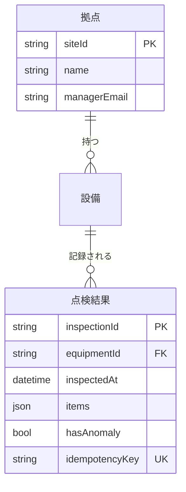

# 機能設計書　SYS-02 クラウドバックエンド

## 表紙

| 項目 | 内容 |
|---|---|
| 文書名 | 機能設計書（クラウドバックエンド） |
| 文書番号 | 【要確認：文書番号の採番規約が OKF にない】 |
| 対象プロダクト | PRD-001 点検ノート |
| 対象システム | SYS-02 クラウドバックエンド（種別：アプリ） |
| 版 | 第 1 版（OKF：SYS-02 revision 1 に対応） |
| 状態 | 作成中（OKF：status draft） |
| 作成日 | 2026-10-03 |
| 作成者 | 【要確認：作成者・承認者が OKF にない（OKF には作成者・レビュー者の属性がない。契約の verified も未記入）】 |
| 作成方法 | OKF バンドル `samples/tenken-note/` を読み、手で作成（生成ツール不使用） |

## 改版履歴

| 版 | 日付 | 内容 | 作成 | 承認 |
|---|---|---|---|---|
| 1 | 2026-10-03 | 初版（OKF log.md「サンプル初版作成」に対応） | 【要確認】 | 【要確認】 |

本書で前提とした OKF の版（すべて revision 1）：SYS-02、CMP-0201〜0205、OBJ-020101／020102／020201／020301／020401／020402／020501、CTR-F-001／003／004／005／006／007／008／009、CTR-N-001〜004、SPC-003〜010。

凡例：
- 【要確認：…】は OKF に情報がなく本書で決められなかった箇所。候補がある場合は「候補：」として併記するが、決定ではない。
- 【矛盾 No.n】は OKF 内の食い違い。詳細は「10 未決事項」を参照。

---

## 1 概要

### 1.1 目的

点検ノート（設備点検をスマホで記録し、クラウドダッシュボードで拠点ごとの状況を確認するサービス）のうち、クラウド側の API・DB・写真ストレージ・異常通知処理を担う SYS-02 の機能を定める。

背景（RUL-001 より）：現場の設備点検が紙で行われ、事務所で毎回エクセルへ転記している。点検場所には電波が届かない場所がある。事務所では拠点ごとの当月の進捗と、異常の即時把握が求められている。

### 1.2 範囲

| 区分 | 内容 |
|---|---|
| 対象 | 点検結果・点検写真の受付と保存（点検API）、拠点進捗の集計（管理API）、異常イベントを受けた管理者へのメール通知（異常通知）、点検 DB の論理設計、写真ストレージの論理設計 |
| 対象外 | モバイルアプリ（SYS-01）、管理ダッシュボード画面（SYS-03）、ネットワーク・DB クラスタ・バケット・コンテナ実行環境の構築（SYS-04、IaC）、メール配信サービス（SYS-05、外部 SaaS）、基幹システム連携（RUL-001 #10 で「調査」扱い、本サンプル対象外） |
| 対象外（OKF に定義がないもの） | 認証・認可、拠点・設備・管理者メールアドレスのマスタ登録・更新機能、写真の取得 API 【要確認：これらを本システムの範囲に含めるか。下記 10 未決事項 No.U-01〜U-03】 |

### 1.3 前提・制約

- 点検 DB の物理（DB クラスタ）は SYS-04 データ基盤（CMP-0402）が提供し、本システムは CTR-F-008 DB接続の取り決め（環境変数 `DB_HOST`、ポート 5432、データベース名 `tenken`、シークレット `tenken/db/app`）だけに依存する。
- 写真バケットは SYS-04 ストレージ基盤（CMP-0403）が提供し、本システムは CTR-F-009（環境変数 `PHOTO_BUCKET`、アプリのロールに PutObject／GetObject のみ許可）だけに依存する。
- API・通知処理は SYS-04 実行環境（CMP-0404、コンテナ実行環境）上で動く。
- 外部への公開は SYS-04 ネットワーク（CMP-0401：公開ドメイン、ロードバランサー、TLS 終端、WAF）を経由する。【要確認：公開ドメイン名・パス（ベース URL）・API とのルーティングを定めた契約が OKF にない（open-issues #28）】
- メール送信は外部サービス（SYS-05）の `POST /v1/send` を用いる（CTR-F-005）。送信上限 100 通/秒（先方プランによる）。
- 利用者：点検者（モバイルアプリ経由）、管理者（ダッシュボード経由・通知メールの受信者）。
- 認証：要件 SPC-001 は「点検者がログイン済み」を前提にしているが、認証方式・認可の取り決めは OKF にない（open-issues #22）。【要確認：認証方式（候補：OIDC／Cognito 等のトークン認証、API キー）、点検者・管理者の権限区分】
- 実装言語・フレームワーク・DB 製品：【要確認：OKF に記載なし。CTR-F-008 のポート 5432 から PostgreSQL 系と推測できるが明記されていない】
- 時刻・タイムゾーン：【要確認：「当月」「inspectedAt」の基準タイムゾーンが OKF にない。候補：JST 固定／UTC 保存・JST 集計】

### 1.4 用語

| 用語 | 意味 | 出典 |
|---|---|---|
| 拠点 | 点検対象設備が属する事業所。管理者のメールアドレスを持つ | CTR-F-003、OBJ-020402 |
| 設備 | 点検の対象。拠点に属する | CTR-F-003（ER 図のみ） |
| 点検結果 | 1 設備に対する 1 回の点検の記録。複数の点検項目（items）を持つ | CTR-F-001、CTR-F-003 |
| 点検項目 | code・result（正常／異常）・comment の組 | CTR-F-001 |
| 冪等キー | 再送時の重複登録を防ぐためのキー（Idempotency-Key ヘッダー） | CTR-F-001、SPC-004 |
| 異常イベント | 異常を含む点検結果の登録時に発行されるメッセージ | CTR-F-007 |
| 完了率 | 点検済数 ÷ 対象数（画面側で計算） | OBJ-030101 |

【要確認：点検項目コード（code）の定義・一覧（コード定義書）が OKF にない。異常通知メールの「異常項目」の表示名にも必要】

---

## 2 構成

### 2.1 コンポーネント構成

| コンポーネントID | 名称 | 種別 | 説明 | 提供する契約 |
|---|---|---|---|---|
| CMP-0201 | 点検API | API定義 | OpenAPI 1 ファイル | CTR-F-001 点検API |
| CMP-0202 | 管理API | API定義 | OpenAPI 1 ファイル | CTR-F-004 管理API |
| CMP-0203 | 異常通知 | 機能群 | 【要確認：説明なし】 | CTR-F-007 異常イベント |
| CMP-0204 | 点検DB | データストア | 【要確認：説明なし】 | CTR-F-003 点検DB |
| CMP-0205 | 写真ストレージ | ファイル群 | オブジェクトストレージ | CTR-F-006 写真ストレージ |

### 2.2 開発オブジェクト構成

```
SYS-02 クラウドバックエンド
├─ CMP-0201 点検API（API定義）
│   ├─ OBJ-020101 点検結果登録API（API）  POST /inspections
│   └─ OBJ-020102 点検写真登録API（API）  PUT /inspections/{id}/photos/{n}
├─ CMP-0202 管理API（API定義）
│   └─ OBJ-020201 拠点進捗取得API（API）  GET /sites/progress
├─ CMP-0203 異常通知（機能群）
│   └─ OBJ-020301 異常通知処理（イベント処理）
├─ CMP-0204 点検DB（データストア）
│   ├─ OBJ-020401 点検結果テーブル（テーブル）
│   ├─ OBJ-020402 拠点テーブル（テーブル）
│   └─ （設備テーブル：ER 図にあるが開発オブジェクト未起票）【要確認】
└─ CMP-0205 写真ストレージ（ファイル群）
    └─ OBJ-020501 点検写真（ファイル）
```

### 2.3 システム間の関係

```
SYS-01 モバイルアプリ ── OBJ-010301 同期処理 ──(CTR-F-001)──→ CMP-0201 点検API
SYS-03 管理ダッシュボード ── OBJ-030101 拠点進捗画面 ──(CTR-F-004)──→ CMP-0202 管理API
CMP-0201 OBJ-020101 ──(CTR-F-007 異常イベント)──→ CMP-0203 OBJ-020301
CMP-0203 OBJ-020301 ──(CTR-F-005)──→ SYS-05 CMP-0501 メール送信API
SYS-02 の各 API・処理 ──(CTR-F-008)──→ SYS-04 CMP-0402 データ基盤
OBJ-020102 ──(CTR-F-009)──→ SYS-04 CMP-0403 ストレージ基盤
```

- 異常イベントの伝達手段（キュー、トピック、同一プロセス内呼び出し等）：【要確認：CTR-F-007 はメッセージの形しか定めておらず、伝達基盤が OKF にない。SYS-04 にもキュー／トピックのリソース定義がない。候補：マネージドキュー（SQS 等）、Pub/Sub】
- 再試行キュー（OBJ-020101 のエラー処理）・デッドレター（OBJ-020301 のエラー処理）：【要確認：どちらも開発オブジェクト・IaC リソース・契約として定義されていない】

---

## 3 機能一覧

| No. | 機能ID | 機能名 | 種別 | 操作／起動 | コンポーネント | 利用者・呼出元 |
|---|---|---|---|---|---|---|
| 1 | OBJ-020101 | 点検結果登録API | API | POST /inspections | CMP-0201 点検API | SYS-01 OBJ-010301 同期処理 |
| 2 | OBJ-020102 | 点検写真登録API | API | PUT /inspections/{id}/photos/{n} | CMP-0201 点検API | SYS-01 OBJ-010301 同期処理 |
| 3 | OBJ-020201 | 拠点進捗取得API | API | GET /sites/progress | CMP-0202 管理API | SYS-03 OBJ-030101 拠点進捗画面 |
| 4 | OBJ-020301 | 異常通知処理 | イベント処理 | 異常イベント（CTR-F-007）受信 | CMP-0203 異常通知 | OBJ-020101（発行側） |

データ・ファイル：

| No. | ID | 名称 | 種別 | コンポーネント |
|---|---|---|---|---|
| 5 | OBJ-020401 | 点検結果テーブル | テーブル | CMP-0204 点検DB |
| 6 | OBJ-020402 | 拠点テーブル | テーブル | CMP-0204 点検DB |
| 7 | （未起票） | 設備テーブル | テーブル | CMP-0204 点検DB【要確認】 |
| 8 | OBJ-020501 | 点検写真 | ファイル | CMP-0205 写真ストレージ |

---

## 4 機能詳細

### 4.1 OBJ-020101 点検結果登録API

#### 4.1.1 概要

| 項目 | 内容 |
|---|---|
| 機能ID／名称 | OBJ-020101 点検結果登録API |
| 操作 | POST /inspections |
| 概要 | 点検結果を 1 件受け付けて保存する。異常を含む場合は異常イベントを発行する。 |
| 呼出元 | SYS-01 OBJ-010301 同期処理（通信回復時に未送信分を自動送信。SPC-003） |
| 契約 | 提供：CTR-F-001（点検API）／利用：CTR-F-003（点検結果テーブル CR）、CTR-F-007（異常イベント 発行）、CTR-F-008（DB接続） |

#### 4.1.2 認証・認可

【要確認：認証方式・認可（点検者ロールのみ可か、自分の担当拠点の設備に限るか）が OKF にない。CTR-F-001 の OpenAPI に securitySchemes がない】

#### 4.1.3 入力

ヘッダー：

| 項目 | 型 | 桁 | 必須 | 説明 |
|---|---|---|---|---|
| Idempotency-Key | 【要確認：OpenAPI に schema なし。候補：string（UUID）】 | 【要確認】 | ○ | 冪等キー。点検結果テーブルの idempotencyKey（UK）に保存 |
| （認証ヘッダー） | 【要確認】 | | | |

本文（application/json）：

| 項目 | 型 | 桁 | 必須 | 説明 |
|---|---|---|---|---|
| equipmentId | string | 【要確認】 | ○ | 設備 ID。設備テーブルに存在すること |
| inspectedAt | string（date-time） | ― | ○ | 点検日時。【要確認：タイムゾーン表記の要否】 |
| items | array | 【要確認：上限件数】 | ○ | 点検項目。1 件以上（処理 2。OpenAPI には minItems なし【矛盾 No.5】） |
| items[].code | string | 【要確認】 | 【要確認：OpenAPI では任意】 | 点検項目コード |
| items[].result | enum（正常／異常） | ― | 【要確認：OpenAPI では任意】 | 判定結果 |
| items[].comment | string | 【要確認】 | 任意 | コメント |

写真は本 API では受け付けず、OBJ-020102 で別途送信する。

#### 4.1.4 出力

| ステータス | 条件 | 本文 |
|---|---|---|
| 201 | 新規登録 | inspectionId（OBJ-020101 処理 5）。【矛盾 No.1：CTR-F-001 の 201 は本文の定義なし】 |
| 200 | 冪等キー重複 | 保存済みの内容（OBJ-020101 処理 1）。【矛盾 No.1：CTR-F-001 の 200 は description のみで本文の定義なし。「保存済みの内容」が inspectionId のみか、点検結果全体かも不明】 |
| 400／404 | エラー | 4.1.7 参照。【矛盾 No.2：CTR-F-001 に 400／404 の定義なし。エラー本文の形式も未定義】 |

#### 4.1.5 処理

| 手順 | 内容 | 出典・補足 |
|---|---|---|
| 1 | Idempotency-Key で点検結果テーブルを検索し、既に存在すれば保存済みの内容を 200 で返す。 | OBJ-020101。【要確認：同じキーで内容が異なる要求が来た場合の扱い（候補：保存済みを返す／409／422）】 |
| 2 | 入力を検証する（equipmentId の存在、items が 1 件以上）。 | OBJ-020101。設備の存在確認には設備テーブルの参照が必要【矛盾 No.3】 |
| 3 | 点検結果テーブルに登録する。items に「異常」が 1 件でもあれば hasAnomaly = true。 | OBJ-020101。【要確認：inspectionId の採番方式（候補：UUID、DB 採番）。受信日時を記録する項目がない（SPC-008 の測定起点に必要）【矛盾 No.9】】 |
| 4 | hasAnomaly = true の場合、異常イベントを発行する。 | OBJ-020101、CTR-F-007。イベント項目の編集は下表。 |
| 5 | 201 で inspectionId を返す。 | OBJ-020101 |

異常イベント（CTR-F-007）の項目の編集：

| イベント項目 | 編集元 | 備考 |
|---|---|---|
| inspectionId | 手順 3 で採番した値 | |
| siteId | 【要確認】 | 点検結果は siteId を持たない。設備テーブル経由で取得する必要があるが、設備テーブルの項目・利用宣言がない【矛盾 No.4】 |
| equipmentId | 入力の equipmentId | |
| anomalyItems | items のうち result = 異常 の code の配列 | |

#### 4.1.6 排他・トランザクション

- 冪等キーの一意性は点検結果テーブルの idempotencyKey の一意制約（UK、CTR-F-003）で担保する。
- 【要確認：同一キーの同時要求で一意制約違反になった場合の応答（候補：再検索して 200 を返す）】
- 【要確認：DB 登録とイベント発行の整合方式。OBJ-020101 のエラー表は「イベント発行失敗でも 201（登録は成功扱い、発行は再試行キューへ）」としており、登録をコミットした後に発行すると読めるが、明記されていない。候補：トランザクショナルアウトボックス】
- 【要確認：冪等キー重複で 200 を返す際、初回でイベント発行に失敗していた場合に再発行するか】

#### 4.1.7 エラー

| No. | 条件 | ステータス | メッセージ | 出典 |
|---|---|---|---|---|
| 1 | 必須項目なし・形式不正 | 400 | 入力内容に誤りがあります | OBJ-020101 |
| 2 | equipmentId が存在しない | 404 | 設備が見つかりません | OBJ-020101 |
| 3 | イベント発行失敗 | 201 | （登録は成功扱い。発行は再試行キューへ） | OBJ-020101。再試行キューの定義なし【要確認】 |
| 4 | 認証エラー・権限エラー | 【要確認】 | 【要確認】 | 定義なし |
| 5 | DB 接続不可などのシステムエラー | 【要確認：候補 500／503】 | 【要確認】 | 定義なし |

#### 4.1.8 ログ

【要確認：出力するログ（アクセスログ・業務ログ・エラーログ）、項目、マスキング対象が OKF にない。監査ログの非機能契約もない（contract.md では「監査ログは非機能契約（セキュリティ）として扱う」としているが、該当する CTR-N がない）】

#### 4.1.9 性能

- CTR-N-002（異常通知の即時性）の配分：**受信から異常イベント発行まで 10 秒以内**（OBJ-020101 に配分）。
- 応答時間・同時接続数・スループット：【要確認：OKF に目標なし。点検件数の見込み（月 10,000 件、SPC-007 の前提）はあるが、ピーク時の到着率がない】

---

### 4.2 OBJ-020102 点検写真登録API

#### 4.2.1 概要

| 項目 | 内容 |
|---|---|
| 機能ID／名称 | OBJ-020102 点検写真登録API |
| 操作 | PUT /inspections/{id}/photos/{n} |
| 概要 | 点検結果に写真を 1 枚追加する。同じ n で再送された場合は上書きする。 |
| 呼出元 | SYS-01 OBJ-010301 同期処理 |
| 契約 | 提供：CTR-F-001／利用：CTR-F-003（点検結果テーブル R）、CTR-F-006（点検写真 C）、CTR-F-008（DB接続）、CTR-F-009（写真バケット） |

#### 4.2.2 認証・認可

【要確認：4.1.2 と同じ。加えて、他人が登録した点検結果に写真を追加できるかの制限】

#### 4.2.3 入力

| 項目 | 位置 | 型 | 桁・範囲 | 必須 | 説明 |
|---|---|---|---|---|---|
| id | パス | 【要確認：OpenAPI に parameters 定義なし。inspectionId と同じ型と推測】 | 【要確認】 | ○ | 点検結果 ID（inspectionId） |
| n | パス | 【要確認：OpenAPI に定義なし。候補：integer】 | 【要確認：開始番号（0／1）と上限枚数】 | ○ | 写真の番号 |
| 本文 | body | image/jpeg | 長辺 2048px 以下（CTR-F-006、OBJ-020102）。【要確認：ファイルサイズ上限】 | ○ | 写真データ |

#### 4.2.4 出力

【矛盾 No.6：CTR-F-001 の PUT に responses の定義がない。OBJ-020102 にも成功時の応答の記載がない。候補：201（新規）／200（上書き）、または 204】

#### 4.2.5 処理

| 手順 | 内容 | 出典・補足 |
|---|---|---|
| 1 | 点検結果テーブルに id が存在することを確認する。 | OBJ-020102 |
| 2 | 画像を検証する（JPEG、長辺 2048px 以下）。 | OBJ-020102、CTR-F-006。【要確認：JPEG 判定方法（Content-Type のみか、マジックナンバーまで見るか）。2048px 超過時に縮小せず 400 にすることは OBJ-020102 のエラー表から読み取れる】 |
| 3 | 写真ストレージにキー規約どおり保存する（`photos/{inspectionId}/{n}.jpg`）。 | OBJ-020102、CTR-F-006。同じ n は上書き |

【要確認：写真の登録有無・枚数を点検結果側に記録するか。現状、点検結果と写真の紐づけはオブジェクトキーのみで、DB に写真の情報はない】

#### 4.2.6 エラー

| No. | 条件 | ステータス | メッセージ | 出典 |
|---|---|---|---|---|
| 1 | 点検結果が存在しない | 404 | 点検結果が見つかりません | OBJ-020102 |
| 2 | 形式・サイズ不正 | 400 | 写真の形式が不正です | OBJ-020102 |
| 3 | ストレージ保存失敗 | 【要確認】 | 【要確認】 | 定義なし |
| 4 | 認証・権限エラー | 【要確認】 | 【要確認】 | 定義なし |

#### 4.2.7 排他・トランザクション

- 同じ n の再送は上書き（OBJ-020102）。DB 更新を伴わないため DB トランザクションはない。
- 【要確認：同じ n への同時 PUT の扱い（最後の書き込みが残る、でよいか）】

#### 4.2.8 ログ

【要確認：4.1.8 と同じ】

#### 4.2.9 性能

【要確認：アップロードの応答時間・最大同時アップロード数の目標が OKF にない。CTR-N-002 は CMP-0201 全体ではなく OBJ-020101 にのみ配分されている】

---

### 4.3 OBJ-020201 拠点進捗取得API

#### 4.3.1 概要

| 項目 | 内容 |
|---|---|
| 機能ID／名称 | OBJ-020201 拠点進捗取得API |
| 操作 | GET /sites/progress |
| 概要 | 指定月の拠点ごとの点検対象数と点検済数を返す。 |
| 呼出元 | SYS-03 OBJ-030101 拠点進捗画面（表示時・対象月の変更時） |
| 契約 | 提供：CTR-F-004（管理API）／利用：CTR-F-003（点検結果テーブル・拠点テーブル R）、CTR-F-008（DB接続） |

#### 4.3.2 認証・認可

【要確認：管理者のみ可か。管理者が全拠点を見られるのか、担当拠点に限るのか】

#### 4.3.3 入力

| 項目 | 位置 | 型 | 桁・形式 | 必須 | 説明 |
|---|---|---|---|---|---|
| month | クエリ | string | 例 "2026-10"（CTR-F-004）。【要確認：pattern（YYYY-MM）の明示なし】 | 任意 | 対象月。未指定時は当月 |

#### 4.3.4 出力

200（application/json）：配列

| 項目 | 型 | 説明 |
|---|---|---|
| siteId | string | 拠点 ID |
| name | string | 拠点名 |
| total | integer | 対象設備数 |
| done | integer | 当月に点検結果がある設備数 |

並び順：拠点名の昇順（OBJ-020201）。画面側では完了率の昇順に並べ替える（OBJ-030101）。

#### 4.3.5 処理

| 手順 | 内容 | 出典・補足 |
|---|---|---|
| 1 | month 未指定の場合は当月とする。 | OBJ-020201。【要確認：当月の判定タイムゾーン】 |
| 2 | 拠点ごとに、対象設備数と、当月に点検結果がある設備数を集計する。 | OBJ-020201。【要確認：「対象設備」の定義（拠点の全設備か、月ごとの点検計画があるか）。ER 図に点検計画・周期の情報はない】【矛盾 No.7：集計に設備テーブルが必要だが uses にない】 |
| 3 | 拠点名の昇順で返す。 | OBJ-020201 |

- 同一設備に当月複数の点検結果がある場合は 1 台と数える（「点検結果がある設備数」の文言から）。
- 【要確認：「当月」を inspectedAt（点検日時）で判定するか、受信日時で判定するか。候補：inspectedAt】
- 【要確認：設備が 0 台の拠点を結果に含めるか（画面の完了率が 0 除算になる）】
- 【要確認：未来月・過去月の指定範囲の制限】

#### 4.3.6 エラー

| No. | 条件 | ステータス | メッセージ | 出典 |
|---|---|---|---|---|
| 1 | month の形式不正 | 400 | 対象月の形式が不正です | OBJ-020201。【矛盾 No.2：CTR-F-004 に 400 の定義なし】 |
| 2 | 認証・権限エラー | 【要確認】 | 【要確認】 | 定義なし |
| 3 | システムエラー | 【要確認】 | 【要確認】 | 定義なし。画面側は API エラー時に「進捗を取得できませんでした」を表示（OBJ-030101） |

#### 4.3.7 排他・トランザクション

参照のみ。【要確認：読み取り一貫性の要求（集計中の登録の扱い）。特段の要求がなければ通常の読み取りでよいか】

#### 4.3.8 ログ

【要確認：4.1.8 と同じ】

#### 4.3.9 性能

| 項目 | 目標 | 出典 |
|---|---|---|
| API 応答（CMP-0202 への配分） | 1.5 秒以内 | CTR-N-001 |
| 集計クエリ（点検結果テーブル・拠点テーブルへの配分） | 0.5 秒以内 | CTR-N-001 |
| 前提データ量 | 拠点 100、設備 10,000 台、当月点検結果 10,000 件 | SPC-007 |
| 全体目標 | 画面を開いてから描画まで p95 3 秒以内 | CTR-N-001、SPC-007 |

【要確認：配分値が p95 か平均か（CTR-N-001 の目標は p95 だが配分値には明記なし）。同時利用者数の見込み】

---

### 4.4 OBJ-020301 異常通知処理

#### 4.4.1 概要

| 項目 | 内容 |
|---|---|
| 機能ID／名称 | OBJ-020301 異常通知処理 |
| 種別 | イベント処理 |
| 概要 | 異常イベントを受け、拠点の管理者へメールで通知する。 |
| 契約 | 提供：CTR-F-007（異常イベントを受け付ける側として提供）／利用：CTR-F-003（拠点テーブル R）、CTR-F-005（メール送信）、CTR-F-008（DB接続） |

#### 4.4.2 起動契機

異常イベント（CTR-F-007）の受信。発行元は OBJ-020101（hasAnomaly = true の点検結果を登録したとき）。

【要確認：受信方式（キューのポーリング、プッシュ型サブスクリプション、同一プロセス内の非同期呼び出し等）。2.3 参照】

#### 4.4.3 入力

| 項目 | 型 | 必須 | 説明 |
|---|---|---|---|
| inspectionId | string | 【要確認：CTR-F-007 に必須の定義なし】 | 点検結果 ID |
| siteId | string | 【要確認】 | 通知先の拠点 |
| equipmentId | string | 【要確認】 | 設備 ID |
| anomalyItems | array of string（code） | 【要確認】 | 異常だった点検項目コード |

【要確認：メッセージのバージョン・発行日時・メッセージ ID（重複排除用）の項目がない】

#### 4.4.4 処理

| 手順 | 内容 | 出典・補足 |
|---|---|---|
| 1 | 異常イベントを受信する。 | OBJ-020301 |
| 2 | 拠点テーブルから siteId の管理者メールアドレスを取得する。 | OBJ-020301。【要確認：管理者が複数いる場合（拠点テーブルの managerEmail は 1 項目）】 |
| 3 | 件名「【点検ノート】異常検知：{設備名}」で、異常項目とダッシュボードの URL を本文に含めて送信 API（POST /v1/send）を呼ぶ。送信元は `no-reply@tenken.example`（CTR-F-005）。 | OBJ-020301。【矛盾 No.8：設備名の取得元がない（イベントに設備名がなく、設備テーブルの利用宣言・項目定義もない）】 |

メール内容：

| 項目 | 内容 | 出典・補足 |
|---|---|---|
| 送信元 | no-reply@tenken.example | CTR-F-005 |
| 宛先 | 拠点テーブルの managerEmail | OBJ-020301、CTR-F-003 |
| 件名 | 【点検ノート】異常検知：{設備名} | OBJ-020301 |
| 本文 | 異常項目、ダッシュボードの URL | OBJ-020301、SPC-006。【要確認：本文テンプレート（文面・異常項目の表示形式＝コードのままか名称か、コメントを含めるか、点検日時・拠点名・点検者を含めるか）】【要確認：ダッシュボード URL の値と、拠点・点検結果を指すパラメータを付けるか（SYS-03 の URL を定めた契約がない）】 |

POST /v1/send の要求項目・認証（API キー等）：【要確認：CTR-F-005 は先方の公開仕様（resource の外部 URL）を参照するのみで、利用する項目の対応表がない。API キーの保管先（シークレット名）も契約にない】

#### 4.4.5 再試行・冪等性

| 項目 | 内容 | 出典・補足 |
|---|---|---|
| 再試行条件 | 送信 API が 5xx・タイムアウト | OBJ-020301 |
| 再試行方式 | 指数バックオフで最大 3 回 | OBJ-020301。【要確認：初回待ち時間・倍率・タイムアウト値。CTR-N-002 の「イベント受信から送信 API 呼び出しまで 1 分以内（リトライ込み）」に収まる値にする必要がある】 |
| 最終失敗時 | デッドレターへ | OBJ-020301。【要確認：デッドレターの実体（キュー名・IaC リソース）、監視・再処理の運用】 |
| 4xx の扱い | 【要確認：定義なし（候補：再試行せずデッドレター）】 | |
| 送信上限超過（429 等） | 【要確認：CTR-F-005 の 100 通/秒の上限超過時の扱い】 | |
| 冪等性 | 【要確認：同じイベントを複数回受信した場合に重複メールを防ぐか（at-least-once 配信なら必要）。重複排除のキー候補：inspectionId】 | SPC-006 は重複について規定なし |

#### 4.4.6 多重度

【要確認：同時処理数（並列度）、順序保証の要否。送信上限 100 通/秒（CTR-F-005）を超えないための制御の要否】

#### 4.4.7 エラー

| No. | 条件 | 対応 | 出典 |
|---|---|---|---|
| 1 | 管理者メール未登録 | ログに警告を出して終了 | OBJ-020301 |
| 2 | 送信 API が 5xx・タイムアウト | 指数バックオフで最大 3 回再試行。失敗したらデッドレターへ | OBJ-020301 |
| 3 | siteId に該当する拠点が存在しない | 【要確認】 | 定義なし |
| 4 | DB 接続不可 | 【要確認：再試行対象か】 | 定義なし |
| 5 | イベントの形式不正 | 【要確認】 | 定義なし |

#### 4.4.8 ログ

- 管理者メール未登録時に警告ログを出す（OBJ-020301）。
- 【要確認：ログ項目（inspectionId、siteId 等）、メールアドレスのマスキング要否、送信成功時のログ、デッドレター投入時のアラート】

#### 4.4.9 性能

| 項目 | 目標 | 出典 |
|---|---|---|
| イベント受信から送信 API 呼び出しまで（CMP-0203 への配分） | 1 分以内（リトライ込み） | CTR-N-002 |
| 全体目標 | 点検結果受信から送信 API 受付まで 5 分以内 | CTR-N-002、SPC-008 |
| 外部（CMP-0501）への配分 | 先方 SLA に依存（自分たちでは制御できない） | CTR-N-002 |

---

## 5 データ設計

### 5.1 ER 図（CTR-F-003 点検DB）



DB 製品・スキーマ名：データベース名 `tenken`（CTR-F-008）。【要確認：DB 製品・スキーマ・文字コード】

### 5.2 テーブル定義

共通の【要確認】：
- 物理テーブル名・物理項目名の命名規約（ER 図の属性名 camelCase を物理名とするか）。
- 項目の桁数（OKF の ER 図に桁の情報がない）。
- 共通項目（作成日時・更新日時・作成者・削除フラグ等）の要否。
- 必須（NOT NULL）は PK・UK 以外は ER 図から判断できない。

#### 5.2.1 OBJ-020401 点検結果テーブル

| No. | 項目名（論理） | 項目名（物理） | 型 | 桁 | 必須 | キー | 説明 |
|---|---|---|---|---|---|---|---|
| 1 | 点検結果ID | inspectionId | string | 【要確認】 | ○ | PK | 【要確認：採番方式】 |
| 2 | 設備ID | equipmentId | string | 【要確認】 | ○（API で必須） | FK（設備） | |
| 3 | 点検日時 | inspectedAt | datetime | ― | ○（API で必須） | | 【要確認：タイムゾーン付きか】 |
| 4 | 点検項目 | items | json | ― | ○（API で必須） | | code・result・comment の配列 |
| 5 | 異常あり | hasAnomaly | bool | ― | 【要確認】 | | items に「異常」が 1 件でもあれば true |
| 6 | 冪等キー | idempotencyKey | string | 【要確認】 | ○（API で必須） | UK | |
| ― | 受信日時 | 【要確認：項目なし】 | | | | | SPC-008 の測定起点・集計の判定に必要か【矛盾 No.9】 |

| 項目 | 内容 |
|---|---|
| CRUD | C：OBJ-020101／R：OBJ-020101、OBJ-020102、OBJ-020201／U・D：なし |
| インデックス | PK（inspectionId）、UK（idempotencyKey）。【要確認：集計用インデックス（候補：equipmentId＋inspectedAt）。CTR-N-001 の集計クエリ 0.5 秒以内のため】 |
| 保持期間 | 【要確認：OKF に定義なし。DB の自動バックアップは 7 日保持（OBJ-040201）だが、データ自体の保持期間ではない】 |
| 件数見込み | 当月 10,000 件（SPC-007 の前提）。【要確認：累積件数・保持期間に応じた総件数】 |

#### 5.2.2 OBJ-020402 拠点テーブル

| No. | 項目名（論理） | 項目名（物理） | 型 | 桁 | 必須 | キー | 説明 |
|---|---|---|---|---|---|---|---|
| 1 | 拠点ID | siteId | string | 【要確認】 | ○ | PK | |
| 2 | 拠点名 | name | string | 【要確認】 | 【要確認】 | | 進捗 API の並び順に使う |
| 3 | 管理者メールアドレス | managerEmail | string | 【要確認】 | 任意（未登録時は通知せず警告。OBJ-020301 から推定） | | |

| 項目 | 内容 |
|---|---|
| CRUD | R：OBJ-020201、OBJ-020301／C・U・D：**なし**【要確認：拠点の登録・更新を行う機能が OKF にない（open-issues #18）】 |
| インデックス | PK（siteId）。【要確認：name のソート用インデックスの要否】 |
| 保持期間 | 【要確認】 |
| 件数見込み | 100 拠点（SPC-007 の前提） |

#### 5.2.3 設備テーブル（開発オブジェクト未起票）

CTR-F-003 の ER 図にエンティティ「設備」があるが、属性の定義がなく、開発オブジェクトも起こされていない（CTR-F-003 の注記、open-issues #19）。

| No. | 項目名 | 型 | 桁 | 必須 | キー | 説明 |
|---|---|---|---|---|---|---|
| 1 | equipmentId（推定） | 【要確認】 | 【要確認】 | ○ | PK | 点検結果の FK の参照先 |
| 2 | siteId（推定） | 【要確認】 | 【要確認】 | ○ | FK（拠点） | ER 図の「拠点 持つ 設備」から推定。異常イベントの siteId の取得元 |
| 3 | 設備名（推定） | 【要確認】 | 【要確認】 | 【要確認】 | | 異常通知メールの件名に使う |

| 項目 | 内容 |
|---|---|
| CRUD | R：OBJ-020101（存在確認）、OBJ-020201（対象数の集計）、OBJ-020301（設備名）が必要だが、いずれも uses に宣言なし【矛盾 No.3・No.7・No.8】／C・U・D：なし |
| 件数見込み | 10,000 台（SPC-007 の前提） |

### 5.3 ファイル設計

#### 5.3.1 OBJ-020501 点検写真

| 項目 | 内容 | 出典 |
|---|---|---|
| 格納先 | 写真バケット（環境変数 `PHOTO_BUCKET` で指定） | CTR-F-009 |
| 形式 | JPEG、長辺 2048px 以下 | CTR-F-006 |
| 命名規約 | `photos/{inspectionId}/{n}.jpg` | CTR-F-006 |
| 1 ファイルの最大サイズ | 【要確認】 | |
| 1 点検あたりの枚数 | 1 枚以上（SPC-001、端末側の要件）。【要確認：上限】 | |
| 作成・更新 | C：OBJ-020102（同じ n は上書き） | OBJ-020102 |
| 参照 | 【要確認：参照する開発オブジェクトがない。SPC-004 は「点検結果に紐づいた写真が取得できる」を求めている【矛盾 No.10】】 | |
| 削除 | なし（CTR-F-009 は PutObject／GetObject のみ許可） | CTR-F-009 |
| 保持 | 【要確認：保持期間・削除の方針。IaC 側の設定として「5 年後に低頻度アクセス層へ移動」がある（OBJ-040301）が、アプリとしての保持期間ではない】 | OBJ-040301 |
| 暗号化 | 保存時暗号化（KMS カスタマーキー）、パブリックアクセス全面禁止 | CTR-N-004、OBJ-040301 |
| 件数見込み | 【要確認：1 点検あたりの平均枚数。月 10,000 点検 × 平均枚数】 | |

---

## 6 インターフェース一覧

### 6.1 提供するインターフェース

| No. | 契約 | 名称 | 形式 | 要素 | 利用者 |
|---|---|---|---|---|---|
| 1 | CTR-F-001 | 点検API | OpenAPI | POST /inspections、PUT /inspections/{id}/photos/{n} | SYS-01 OBJ-010301 同期処理 |
| 2 | CTR-F-004 | 管理API | OpenAPI | GET /sites/progress | SYS-03 OBJ-030101 拠点進捗画面 |
| 3 | CTR-F-007 | 異常イベント | メッセージ定義 | 異常イベント（inspectionId, siteId, equipmentId, anomalyItems） | 発行側：OBJ-020101（システム内） |
| 4 | CTR-F-003 | 点検DB | ER 図 | 拠点、設備、点検結果 | OBJ-020101／020102／020201／020301（システム内） |
| 5 | CTR-F-006 | 写真ストレージ | キー規約 | 点検写真 | OBJ-020102（システム内） |

- API の共通仕様（ベース URL、認証ヘッダー、エラー本文の形式、文字コード、バージョニング）：【要確認：OKF にない】

### 6.2 利用するインターフェース

| No. | 契約 | 名称 | 提供元 | 内容 | 利用者 |
|---|---|---|---|---|---|
| 1 | CTR-F-005 | メール送信 | SYS-05 CMP-0501（外部） | POST /v1/send、送信元 no-reply@tenken.example、上限 100 通/秒 | OBJ-020301 |
| 2 | CTR-F-008 | DB接続 | SYS-04 CMP-0402 | DB_HOST／5432／tenken／シークレット tenken/db/app | OBJ-020101／020102／020201／020301 |
| 3 | CTR-F-009 | 写真バケット | SYS-04 CMP-0403 | PHOTO_BUCKET、PutObject／GetObject のみ | OBJ-020102 |
| 4 | 【要確認】 | 公開エンドポイント | SYS-04 CMP-0401 | ドメイン・ルーティング | 全 API（open-issues #28） |
| 5 | 【要確認】 | イベント伝達基盤（キュー等） | 【要確認】 | 異常イベントの伝達・再試行キュー・デッドレター | OBJ-020101、OBJ-020301 |
| 6 | 【要確認】 | 認証基盤 | 【要確認】 | 点検者・管理者の認証 | 全 API（open-issues #22） |

---

## 7 メッセージ一覧

メッセージ ID の採番規約は OKF にない。【要確認：メッセージ ID 体系・多言語対応の要否・API 応答本文での返し方（コードと文言の両方か）】

| No. | メッセージID | 区分 | 文言 | 使用箇所 | 出典 |
|---|---|---|---|---|---|
| 1 | 【要確認】 | エラー（400） | 入力内容に誤りがあります | OBJ-020101 | OBJ-020101 |
| 2 | 【要確認】 | エラー（404） | 設備が見つかりません | OBJ-020101 | OBJ-020101 |
| 3 | 【要確認】 | エラー（404） | 点検結果が見つかりません | OBJ-020102 | OBJ-020102 |
| 4 | 【要確認】 | エラー（400） | 写真の形式が不正です | OBJ-020102 | OBJ-020102 |
| 5 | 【要確認】 | エラー（400） | 対象月の形式が不正です | OBJ-020201 | OBJ-020201 |
| 6 | 【要確認】 | ログ（警告） | 【要確認：文言なし。「管理者メール未登録」時】 | OBJ-020301 | OBJ-020301 |
| 7 | ― | メール件名 | 【点検ノート】異常検知：{設備名} | OBJ-020301 | OBJ-020301 |
| 8 | ― | メール本文 | 【要確認：テンプレートなし】 | OBJ-020301 | |

参考（SYS-03 側）：API エラー時の画面表示「進捗を取得できませんでした」（OBJ-030101）。

---

## 8 非機能要件

| No. | 契約 | 品質特性 | 全体目標 | 本システムへの配分 | 要件 |
|---|---|---|---|---|---|
| 1 | CTR-N-001 | 性能効率性 | 拠点進捗の表示 3 秒以内（p95） | CMP-0202 管理API：API 応答 1.5 秒以内／OBJ-020401・020402：集計クエリ 0.5 秒以内 | SPC-007 |
| 2 | CTR-N-002 | 性能効率性 | 点検結果受信から送信 API 受付まで 5 分以内 | OBJ-020101：受信から異常イベント発行まで 10 秒以内／CMP-0203 異常通知：イベント受信から送信 API 呼び出しまで 1 分以内（リトライ込み） | SPC-008 |
| 3 | CTR-N-003 | 可用性 | 平日 8〜20 時の月間稼働率 99.5% | 本システムへの直接配分なし（SYS-04 CMP-0404：2 AZ 各 1 タスク以上・自動置き換え、CMP-0402：マルチ AZ・自動フェイルオーバー） | SPC-009 |
| 4 | CTR-N-004 | セキュリティ | 点検データを端末内・通信経路・クラウド上で暗号化 | 本システムへの直接配分なし（CMP-0401：TLS 1.2 以上、CMP-0402・0403：保存時暗号化 KMS） | SPC-010 |

本システムとして【要確認】の非機能項目：
- 業務時間外（平日 8〜20 時以外）の運用・停止の可否、計画停止の扱い。
- 障害時の DB 再接続（フェイルオーバー時のアプリ側の再試行）。CTR-N-003 は物理側に配分されているが、アプリ側の振る舞いの取り決めがない。
- 点検 API・写真 API の応答時間、スループット、同時接続数。
- ログ・監視・アラート（デッドレター監視を含む）。
- 監査ログ（contract.md では非機能契約（セキュリティ）で扱うとしているが、該当契約がない）。
- データ保持期間・バックアップからの復旧目標（RPO／RTO）。
- 個人情報（管理者メールアドレス）の取り扱い。

---

## 9 トレーサビリティ

### 9.1 要件 → 契約 → 開発オブジェクト

| 要件 | 区分 | 契約（参照範囲） | 本システムの開発オブジェクト |
|---|---|---|---|
| SPC-003 通信回復時に未送信の点検結果と写真を自動送信する | 機能 | CTR-F-001（OBJ-020101、020102） | OBJ-020101、OBJ-020102（受け側） |
| SPC-004 受信した点検結果と写真を保存する | 機能 | CTR-F-001（OBJ-020101、020102）、CTR-F-003（OBJ-020401）、CTR-F-006（OBJ-020501） | OBJ-020101、OBJ-020102、OBJ-020401、OBJ-020501 |
| SPC-005 拠点ごとの当月点検完了率を表示する | 機能 | CTR-F-004（OBJ-020201） | OBJ-020201 |
| SPC-006 異常ありの点検結果を受信したら管理者へメール通知する | 機能 | CTR-F-007（CMP-0203 全体）、CTR-F-005（CMP-0501 全体）、CTR-F-003（OBJ-020402） | OBJ-020101（発行）、OBJ-020301、OBJ-020402 |
| SPC-007 拠点進捗を 3 秒以内に表示する | 非機能 | CTR-N-001 | CMP-0202（OBJ-020201）、OBJ-020401、OBJ-020402 |
| SPC-008 異常通知を受信から 5 分以内に送信する | 非機能 | CTR-N-002 | OBJ-020101、CMP-0203（OBJ-020301） |
| SPC-009 稼働率 99.5% | 非機能 | CTR-N-003 | （SYS-04 へ配分。本システムは対象 API として関係） |
| SPC-010 暗号化 | 非機能 | CTR-N-004 | （SYS-04 へ配分。OBJ-020401・020402・020501 が保護対象） |

### 9.2 受入基準と本書の対応

| 要件 | 受入基準 | 本書の対応箇所 |
|---|---|---|
| SPC-004 | 同じ冪等キーで 2 回送信 → 1 件だけ保存、2 回目も成功応答 | 4.1.5 手順 1、4.1.6 |
| SPC-004 | 写真を送信 → 点検結果に紐づいた写真が取得できる | 4.2、5.3.1。**取得手段がない**【矛盾 No.10】 |
| SPC-005 | 対象 10 台・送信済 4 台 → 完了率 40% | 4.3（total・done を返す。率の計算は画面側） |
| SPC-006 | 異常あり → 設備名・異常項目・ダッシュボードリンクを含むメール | 4.4。設備名の取得元なし【矛盾 No.8】 |
| SPC-006 | 異常なし → メールなし | 4.1.5 手順 4（hasAnomaly = false なら発行しない） |
| SPC-007 | 拠点 100／設備 10,000／点検 10,000 で p95 3 秒以内 | 4.3.9 |
| SPC-008 | 受信時刻から送信 API 受付まで 5 分以内 | 4.1.9、4.4.9。受信時刻の記録なし【矛盾 No.9】 |

### 9.3 上流（要求・要望）

| 要件 | 要求 | 要望 |
|---|---|---|
| SPC-003 | REQ-001、REQ-002 | WSH-001、WSH-002 |
| SPC-004 | REQ-001、REQ-003 | WSH-001、WSH-003 |
| SPC-005、SPC-007 | REQ-003 | WSH-001、WSH-003 |
| SPC-006、SPC-008 | REQ-004 | WSH-003、WSH-004 |
| SPC-009 | REQ-005 | WSH-005 |
| SPC-010 | REQ-006 | WSH-006 |

---

## 10 未決事項

### 10.1 OKF 内の矛盾・食い違い

| No. | 内容 | 関係する OKF | 対応案 |
|---|---|---|---|
| 1 | POST /inspections の成功応答：OBJ-020101 は「201 で inspectionId を返す」「200 で保存済みの内容を返す」とするが、CTR-F-001 の 201・200 に本文スキーマがない | OBJ-020101、CTR-F-001 | CTR-F-001 に応答スキーマを追加（契約の改版） |
| 2 | エラー応答：OBJ-020101（400／404）、OBJ-020201（400）、OBJ-020102（400／404）のエラーが、CTR-F-001・CTR-F-004 の OpenAPI に定義されていない。エラー本文の形式も未定義 | OBJ-020101／020102／020201、CTR-F-001、CTR-F-004 | OpenAPI にエラー応答と共通エラースキーマを追加 |
| 3 | POST /inspections は「equipmentId の存在」を検証するが、設備テーブルの開発オブジェクトがなく、uses にも宣言がない（CRUD は点検結果テーブルの CR のみ） | OBJ-020101、CTR-F-003（open-issues #19・#25） | 設備テーブルを起票し、uses に R を追加 |
| 4 | 異常イベントは siteId を持つが、点検結果テーブルにも入力にも siteId がない。設備 → 拠点の関連を読む必要があるが、設備の属性・利用宣言がない | OBJ-020101、CTR-F-007、CTR-F-003 | 設備テーブルに siteId を定義し、OBJ-020101 の uses に追加 |
| 5 | items の件数：OBJ-020101 は「1 件以上」を検証するが、CTR-F-001 に minItems がない。items[].code・result の必須も OpenAPI では未指定 | OBJ-020101、CTR-F-001 | OpenAPI に minItems: 1 と items の required を追加 |
| 6 | PUT /inspections/{id}/photos/{n}：CTR-F-001 にパスパラメータ（id・n）・responses の定義がない。OBJ-020102 には 404／400 がある | OBJ-020102、CTR-F-001 | OpenAPI に parameters・responses を追加 |
| 7 | GET /sites/progress は拠点ごとの「対象設備数」を集計するが、uses は点検結果テーブル・拠点テーブルのみで設備テーブルがない。CTR-N-001 の集計クエリの配分先も同じ 2 テーブルのみ | OBJ-020201、CTR-N-001 | 設備テーブルを uses・配分先に追加 |
| 8 | 異常通知メールの件名に {設備名} を使うが、異常イベント（CTR-F-007）に設備名がなく、OBJ-020301 は設備テーブルを利用宣言していない。設備名の属性自体も ER 図にない。SPC-006 の受入基準は設備名を必須としている | OBJ-020301、CTR-F-007、CTR-F-003、SPC-006 | イベントに設備名を追加するか、OBJ-020301 が設備テーブルを読むかを裁定 |
| 9 | SPC-008 は「点検結果の受信時刻」から測るが、点検結果テーブルに受信日時の項目がない | SPC-008、CTR-F-003 | 受信日時（候補：receivedAt）の追加を検討 |
| 10 | SPC-004 の受入基準「点検結果に紐づいた写真が取得できる」に対応する取得 API・開発オブジェクトがない（CTR-F-009 は GetObject を許可しているのみ） | SPC-004、CTR-F-001、CTR-F-009 | 写真取得 API を追加するか、受入基準を「ストレージに保存されている」に改めるかを裁定 |
| 11 | OBJ-020101 は「イベント発行失敗 → 再試行キューへ」、OBJ-020301 は「デッドレターへ」とするが、どちらの実体も開発オブジェクト・契約・IaC リソースとして存在しない | OBJ-020101、OBJ-020301、SYS-04 | イベント伝達基盤を IaC コンポーネントとして起票し、契約を置く |
| 12 | 拠点テーブル（および設備テーブル）を登録・更新する開発オブジェクトが存在しない（CRUD の C・U がない） | OBJ-020402、CTR-F-003（open-issues #18） | マスタ管理機能の要件・開発オブジェクトの追加 |
| 13 | 契約のフロントマターに `elements`（含む要素の一覧）がない。docs/concepts/contract.md・docs/overview.md では置くとしている。contract.md の例にある CTR-F-003 の `resource: design/er/tenken-db.md` も実体と異なる | CTR-F-001〜009、docs/concepts/contract.md | サンプルに elements を反映（open-issues の「#32 → サンプルへの反映は未実施」に該当） |
| 14 | SPC-001 は「点検者がログイン済み」を前提とするが、認証の要件・契約・開発オブジェクトがどこにもない | SPC-001（open-issues #22） | 認証の契約を追加 |

### 10.2 本書で【要確認】とした主な事項

| No. | 内容 | 該当節 |
|---|---|---|
| U-01 | 認証方式・認可（ロール、拠点単位のアクセス制御） | 1.3、4.x.2 |
| U-02 | マスタ（拠点・設備・管理者メール）登録機能の有無と担当システム | 1.2、5.2 |
| U-03 | 写真取得機能の有無 | 1.2、5.3.1 |
| U-04 | 異常イベントの伝達基盤、再試行キュー、デッドレター、配信保証と重複メール防止 | 2.3、4.1.6、4.4.5 |
| U-05 | 登録とイベント発行の整合方式（アウトボックス等） | 4.1.6 |
| U-06 | 冪等キーの形式、同一キー・異なる内容の扱い、同時要求の扱い、キーの保持期間 | 4.1.3、4.1.5、4.1.6 |
| U-07 | タイムゾーン（当月の判定、inspectedAt） | 1.3、4.3.5 |
| U-08 | 「対象設備」の定義（全設備か、点検計画があるか） | 4.3.5 |
| U-09 | 項目の桁数・必須・物理名・共通項目・インデックス | 5.2 |
| U-10 | データ保持期間（点検結果・写真）、件数見込み（累積） | 5.2、5.3 |
| U-11 | 写真のサイズ上限・枚数上限・n の範囲・成功応答 | 4.2 |
| U-12 | メール本文テンプレート、ダッシュボード URL、異常項目の表示名（コード定義） | 4.4.4 |
| U-13 | 再試行の待ち時間・タイムアウト、4xx・送信上限超過時の扱い、並列度 | 4.4.5、4.4.6 |
| U-14 | ログ・監査ログ・監視の方針 | 4.x.8、8 |
| U-15 | API 共通仕様（ベース URL、エラー本文形式、バージョニング）、公開エンドポイントの契約 | 6.1、6.2 |
| U-16 | メッセージ ID 体系 | 7 |
| U-17 | 実装言語・DB 製品 | 1.3、5.1 |
| U-18 | 点検 API・写真 API・異常通知の性能目標（配分のない部分） | 4.1.9、4.2.9、8 |
| U-19 | 文書番号・作成者・承認者 | 表紙 |
