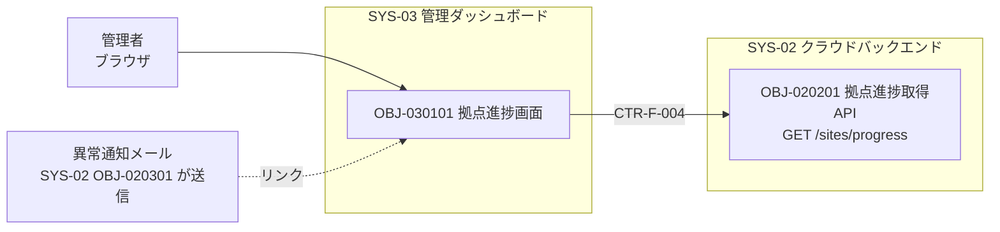
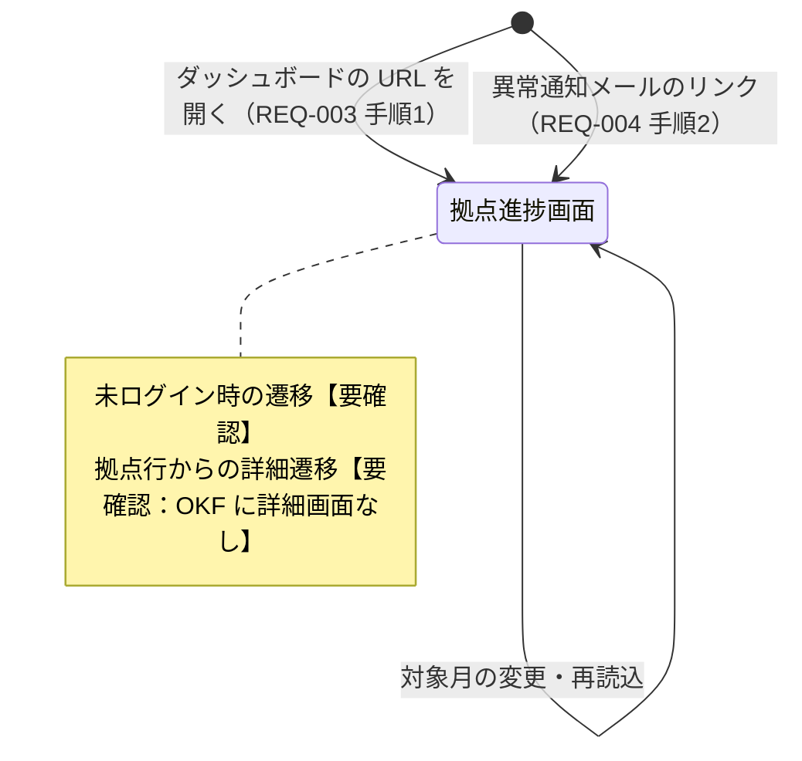

# 機能設計書　SYS-03 管理ダッシュボード

## 表紙

| 項目 | 内容 |
|---|---|
| 文書名 | 機能設計書（SYS-03 管理ダッシュボード） |
| プロダクト | PRD-001 点検ノート |
| システム | SYS-03 管理ダッシュボード（種別：アプリ） |
| 文書番号 | 【要確認：文書番号の採番規則が OKF にない】 |
| 版 | 第 1 版（OKF：SYS-03 revision 1） |
| 状態 | 作成中（OKF：status draft） |
| 作成日 | 2026-10-03（OKF log.md「サンプル初版作成」の日付） |
| 作成者 | 【要確認：作成者・承認者が OKF にない】 |
| 承認者 | 【要確認】 |

本書は OKF バンドル `samples/tenken-note/` を正本として、設計者が手で作成した。OKF に記載がない事項は「【要確認：…】」と記す。

## 改版履歴

| 版 | 日付 | 改版内容 | 根拠（OKF） | 作成者 |
|---|---|---|---|---|
| 1 | 2026-10-03 | 初版作成 | log.md 2026-10-03「サンプル初版作成」、SYS-03／CMP-0301／OBJ-030101 すべて revision 1 | 【要確認】 |

---

## 1. 概要

### 1.1 目的

事務所の管理者が、拠点ごとの当月の点検進捗（完了率）をダッシュボードで確認できるようにする（REQ-003、SPC-005）。あわせて、異常通知メールのリンクからダッシュボードを開けるようにする（REQ-004 のユースケース手順2）。

背景（RUL-001 #1, #5）：事務所で毎回エクセルに転記している。拠点ごとに今月の点検がどこまで終わっているかを知りたい。

### 1.2 範囲

| 区分 | 対象 |
|---|---|
| 画面 | OBJ-030101 拠点進捗画面 |

対象外：
- 拠点進捗の集計 API（SYS-02 OBJ-020201）。本書では CTR-F-004 管理API の利用側としてのみ記す。
- 異常通知メールの送信（SYS-02 OBJ-020301）。本書ではメール中のリンクの受け側としてのみ記す。
- ログイン・認証（OKF に認証の開発オブジェクト・契約がない。open-issues #22）。【要確認：ログイン画面を SYS-03 の範囲に含めるか】
- 拠点・設備・管理者（メールアドレス）の登録・保守（open-issues #18 で「登録する要件が抜けている」とされている）。【要確認：マスタ保守画面を SYS-03 に置くか】
- SPA の配信基盤（静的ホスティング等）。成果物ツリー（SYS-04）に該当するオブジェクトがない。【要確認】

### 1.3 前提・制約

| No | 前提・制約 | 出典 |
|---|---|---|
| 1 | Web 画面（SPA） | SYS-03 本文 |
| 2 | 利用者は管理者 | SYS-03 本文、REQ-003 の主語 |
| 3 | 拠点進捗の表示は 3 秒以内（p95）。うち画面の描画は 1.0 秒以内 | SPC-007、CTR-N-001 |
| 4 | 想定データ量：拠点 100、設備 10,000 台、当月点検結果 10,000 件 | SPC-007 受入基準（前提） |
| 5 | 対応ブラウザ・画面解像度 | 【要確認：OKF にない】 |
| 6 | SPA のフレームワーク | 【要確認：OKF にない】 |
| 7 | 業務時間（平日 8〜20 時）の利用 | REQ-005。ただし可用性の配分はクラウド（CMP-0404、CMP-0402）のみで SYS-03 にはない |

### 1.4 用語

| 用語 | 意味 | 出典 |
|---|---|---|
| 管理者 | 事務所で拠点ごとの点検状況を確認する利用者。拠点ごとに管理者メールアドレスが登録される | REQ-003、CTR-F-003（managerEmail） |
| 対象数 | 拠点ごとの点検対象設備数（total） | CTR-F-004、OBJ-020201 |
| 点検済数 | 拠点ごとの、当月に点検結果がある設備数（done） | CTR-F-004、OBJ-020201 |
| 完了率 | done / total（%） | OBJ-030101 |

---

## 2. 構成

### 2.1 コンポーネント構成

| コンポーネントID | 名称 | 種別 | 説明 | 版 |
|---|---|---|---|---|
| CMP-0301 | 進捗ダッシュボード | 機能群 | 【要確認：OKF 本文が見出しのみ】 | 1 |

### 2.2 構成図



補足：
- メールのリンク → 画面のつながりは REQ-004 のユースケースから読み取れるだけで、契約・URL の定義はない。【要確認：Q-04】
- SPA の配信元（ホスティング）と API への経路（同一ドメインか、CORS か）は OKF にない。【要確認】

---

## 3. 機能一覧

### 3.1 機能一覧

| 機能ID | 機能名 | 種別 | コンポーネント | 概要 | 関連要件 |
|---|---|---|---|---|---|
| OBJ-030101 | 拠点進捗画面 | 画面 | CMP-0301 | 拠点ごとの当月の点検完了率を一覧で確認する | SPC-005、SPC-007 |

### 3.2 画面一覧

| 画面ID | 画面名 | 利用者 | 起動元 | 主な用途 | ユースケース（出典） |
|---|---|---|---|---|---|
| OBJ-030101 | 拠点進捗画面 | 管理者 | ダッシュボードを開く／異常通知メールのリンク | 対象月を選び、完了率の低い拠点を確認する | REQ-003 手順1・2、REQ-004 手順2 |

### 3.3 画面遷移図

画面は 1 つのため、遷移は入口のみ。OKF に画面遷移の定義はなく、以下は要求のユースケースから推定した。



| 遷移元 | 契機 | 遷移先 | 根拠 |
|---|---|---|---|
| （外部） | ダッシュボードの URL を開く | 拠点進捗画面 | REQ-003 ユースケース |
| （外部）異常通知メール | リンクを開く | 拠点進捗画面 | REQ-004 ユースケース。リンクの URL・パラメータ（対象月・拠点の指定）【要確認】 |
| （未ログイン） | ― | 【要確認：ログイン画面】 | 認証の定義なし |
| 拠点進捗画面 | 拠点行の選択 | 【要確認：遷移先なし。異常の内容を確認する画面が OKF にない】 | ― |

---

## 4. 機能詳細

### 4.1 OBJ-030101 拠点進捗画面

| 項目 | 内容 |
|---|---|
| 画面ID | OBJ-030101 |
| 画面名 | 拠点進捗画面 |
| コンポーネント | CMP-0301 進捗ダッシュボード |
| 版 | 1 |
| 呼び出す API | OBJ-020201 GET /sites/progress（CTR-F-004 r1） |

#### 4.1.1 概要

管理者が拠点ごとの当月の点検完了率を一覧で確認する（OBJ-030101 本文）。対象月を選び（REQ-003 手順1）、完了率の低い拠点を確認する（REQ-003 手順2）。

#### 4.1.2 画面レイアウト

```
┌────────────────────────────────────┐
│ （画面レイアウトは別途作成）                       │
│  ・対象月（月選択）                                │
│  ・拠点進捗表：拠点名／対象数／点検済数／完了率    │
│     完了率 50% 未満の行は強調表示                  │
│  ・（エラー時）メッセージ＋再読込ボタン            │
└────────────────────────────────────┘
```

【要確認：レイアウト画像の所在。グラフ表示の有無（「ダッシュボード」の語から想定されうるが OKF は表のみ）】

#### 4.1.3 画面項目

| No | 項目名 | 種類 | 入出力 | 必須 | 桁・形式 | 初期値 | 説明 |
|---|---|---|---|---|---|---|---|
| 1 | 対象月 | 月選択 | 入力 | 【要確認：未選択を許すか。API は未指定時に当月】 | YYYY-MM（CTR-F-004 の例 "2026-10" から推定）【要確認】 | 当月 | GET /sites/progress の month。選択できる範囲（過去何か月・未来月）【要確認】 |
| 2 | 拠点進捗表 | 一覧 | 出力 | ― | ― | ― | API 応答の配列。並びは完了率の昇順。同率時の順序【要確認：候補＝API の並び（拠点名昇順）を保持】 |
| 2-1 | 拠点名 | 表示 | 出力 | ― | 【要確認】 | ― | name |
| 2-2 | 対象数 | 表示 | 出力 | ― | 整数。表示書式（桁区切り）【要確認】 | ― | total |
| 2-3 | 点検済数 | 表示 | 出力 | ― | 整数。表示書式【要確認】 | ― | done |
| 2-4 | 完了率 | 表示 | 出力 | ― | 整数 ％（小数点以下切り捨て） | ― | done / total。total＝0 のときの表示【要確認：候補＝「―」／0%／100%】 |
| 2-5 | 強調表示 | 表示属性 | 出力 | ― | ― | ― | 完了率 50% 未満の行。境界（ちょうど 50%）は強調しない（「未満」の文言どおり）。強調の表現（色・アイコン）【要確認】 |
| 3 | 再読込 | ボタン | 入力 | ― | ― | 非表示 | API エラー時のみ表示 |
| ― | 拠点ID | 保持 | ― | ― | ― | ― | siteId（API 応答にあり、画面での用途の記載なし）【要確認：表示しないか】 |

#### 4.1.4 操作・イベント

| No | 契機 | 処理 | 出典 |
|---|---|---|---|
| 1 | 画面表示時 | 対象月＝当月で GET /sites/progress を呼ぶ | OBJ-030101 処理1 |
| 2 | 対象月の変更 | 選択した月で GET /sites/progress を呼ぶ | OBJ-030101 処理1 |
| 3 | 応答受信 | 完了率を計算し、完了率の昇順に並べ、50% 未満の行を強調表示する | OBJ-030101 処理2 |
| 4 | 再読込ボタン押下 | 直前の対象月で GET /sites/progress を再度呼ぶ | OBJ-030101 エラー（推定） |
| 5 | 通信中 | 【要確認：読込中表示の有無、連続した対象月変更時の古い応答の扱い】 | ― |
| 6 | 「当月」の判定 | 【要確認：ブラウザの時刻か、サーバ（API 未指定時の当月）か。タイムゾーン】 | ― |
| 7 | 自動更新 | 【要確認：一定間隔での自動再取得の有無】 | ― |
| 8 | 拠点行の選択 | 【要確認：遷移なし（3.3）】 | ― |

#### 4.1.5 画面遷移

3.3 を参照。

#### 4.1.6 入力チェック

| No | 対象 | チェック内容 | 根拠 |
|---|---|---|---|
| 1 | 対象月 | 年月として正しいこと | OBJ-020201（API 側で「対象月の形式が不正です」400）。画面側は月選択部品のため不正値は入らない想定【要確認】 |
| 2 | 対象月 | 選択可能範囲内であること | 【要確認：範囲の定義なし】 |

#### 4.1.7 メッセージ

| No | 条件 | メッセージ | 種別 | 出典 |
|---|---|---|---|---|
| 1 | API エラー | 進捗を取得できませんでした | エラー | OBJ-030101 エラー |
| 2 | 拠点 0 件 | 【要確認】 | 情報 | ― |
| 3 | 未認証・権限なし | 【要確認】 | エラー | ― |

「API エラー」に何を含むか（400／401／403／5xx／タイムアウト）の区別は OKF にない。【要確認】

#### 4.1.8 権限

| 利用者 | 表示できる拠点 | 根拠 |
|---|---|---|
| 管理者 | 【要確認：全拠点か、自分が管理者として登録された拠点のみか】 | WSH-003 は「全拠点の点検状況をまとめて見たい」、一方 CTR-F-003 は拠点ごとに managerEmail を持ち、SPC-006 は「拠点の管理者」へ通知する。管理者が拠点に属するのか全社なのかが OKF から決められない |
| 点検者 | 【要確認：閲覧可否】 | ― |

認証方式（ID・パスワード／SSO 等）は OKF にない。【要確認】

#### 4.1.9 性能

| 項目 | 目標 | 出典 |
|---|---|---|
| 画面を開いてから進捗表が描画されるまで | 3 秒以内（p95） | SPC-007、CTR-N-001 target |
| 画面側の描画 | 1.0 秒以内 | CTR-N-001（CMP-0301 への配分） |
| 前提データ量 | 拠点 100（＝表 100 行）、設備 10,000、当月点検結果 10,000 | SPC-007 |

100 行を 1 画面に表示するか（ページング・スクロール）は【要確認】。

---

## 5. データ設計

SYS-03 に端末内・ブラウザ内のテーブルはない（成果物ツリーに該当する開発オブジェクトなし）。

| データ | 用途 | 状況 |
|---|---|---|
| 拠点進捗（API 応答） | 画面表示 | 画面のメモリ内でのみ保持（推定） |
| 選択中の対象月 | 画面状態 | URL・ブラウザ保存の要否【要確認：メールリンクからの指定とも関係】 |
| 認証情報（セッション・トークン） | API 呼び出し | 【要確認：認証の定義なし】 |

参照するクラウド側のデータ（SYS-02、CTR-F-003 点検DB）：拠点（siteId, name, managerEmail）、点検結果、設備（属性・開発オブジェクト未作成）。「対象設備数」をどう数えるか（設備に点検周期や対象月の属性があるか）は CTR-F-003 にない。【要確認：Q-02】

---

## 6. インターフェース一覧

| IF-No | 方向 | 相手 | 契約 | オペレーション | 利用する開発オブジェクト | 備考 |
|---|---|---|---|---|---|---|
| IF-01 | 呼出 | SYS-02 OBJ-020201 拠点進捗取得API | CTR-F-004 管理API（r1、OpenAPI） | GET /sites/progress?month= | OBJ-030101 | 応答：[{siteId, name, total, done}] |
| IF-02 | 受入 | 異常通知メール（SYS-02 OBJ-020301 が送信） | 【要確認：契約なし】 | ダッシュボードの URL | OBJ-030101 | REQ-004 手順2、SPC-006（メールにダッシュボードへのリンクを含む） |
| IF-03 | 送受信 | 認証 | 【要確認：契約なし】 | 【要確認】 | OBJ-030101 | ― |

IF-01 で OKF にないもの：
- エラー応答（OBJ-020201 は 400「対象月の形式が不正です」を返すが、CTR-F-004 に 400 の定義がない）
- 接続先 URL・認証ヘッダ・タイムアウト値【要確認】
- month の形式の定義（例 "2026-10" のみで pattern がない）【要確認】
- 応答の並び順は OBJ-020201 本文に「拠点名の昇順」とあるが CTR-F-004 にはない

---

## 7. メッセージ一覧

OKF に文言があるのは No.1 のみ。ID は本書で仮に振った番号である。

| メッセージID | 画面 | 種別 | 表示条件 | 文言 | 出典 |
|---|---|---|---|---|---|
| M03-001 | 拠点進捗画面 | エラー | API エラー | 進捗を取得できませんでした | OBJ-030101 |
| M03-002 | 拠点進捗画面 | 情報 | 拠点 0 件 | 【要確認】 | ― |
| M03-003 | 拠点進捗画面 | エラー | 未認証・権限なし | 【要確認】 | ― |

参考（API が返すメッセージ。画面で表示するかは【要確認】）：

| API | 条件 | メッセージ（OKF 記載） |
|---|---|---|
| GET /sites/progress | 400 | 対象月の形式が不正です |

---

## 8. 非機能要件

| No | 品質特性 | 契約 | 目標（全体） | SYS-03 への配分 | 関連要件 |
|---|---|---|---|---|---|
| 1 | 性能効率性 | CTR-N-001 ダッシュボード応答性能 | 拠点進捗の表示 3 秒以内（p95） | CMP-0301：描画 1.0 秒以内 | SPC-007（REQ-003） |

CTR-N-001 の他の配分（参考）：CMP-0202 管理API：API 応答 1.5 秒以内、OBJ-020401／020402：集計クエリ 0.5 秒以内。

補足・確認事項：
- CTR-N-001 本文は「配分の合計（3.0 秒）が目標と一致」とするが、集計クエリ（0.5 秒）は API 応答（1.5 秒）の内側で実行されるため、足し合わせると二重に数えている。また、ネットワーク転送・SPA の読込時間がどこにも配分されていない。【要確認：C-03】
- 可用性（CTR-N-003、REQ-005／SPC-009）の配分は CMP-0404・CMP-0402 のみで、SPA の配信基盤への配分がない。SPC-009 の受入基準は「点検 API とダッシュボードが利用できる」としている。【要確認】
- 通信の暗号化（CTR-N-004）は CMP-0401（TLS 1.2 以上）に配分されている。ダッシュボードの通信が同じロードバランサーを通るかは OKF にない。【要確認】
- 監査ログ（誰がいつ閲覧したか）、セッションタイムアウトは OKF にない。【要確認】

---

## 9. トレーサビリティ

| 要望 | 要求 | 要件 | 契約（範囲） | 本書の開発オブジェクト | 経路 |
|---|---|---|---|---|---|
| WSH-003, WSH-001 | REQ-003 | ― | ― | OBJ-030101 | ユースケース（手順1・2） |
| WSH-004, WSH-003 | REQ-004 | ― | ― | OBJ-030101 | ユースケース（手順2：メールのリンク） |
| WSH-003, WSH-001 | REQ-003 | SPC-005 | CTR-F-004（OBJ-020201） | OBJ-030101 | 利用 |
| WSH-003, WSH-001 | REQ-003 | SPC-007 | CTR-N-001（CMP-0301 へ配分） | OBJ-030101 | 非機能配分 |
| WSH-004 | REQ-004 | SPC-006 | CTR-F-007, CTR-F-005, CTR-F-003 | （なし） | SPC-006 の受入基準「ダッシュボードへのリンクを含む」は SYS-03 の URL に依存するが、OKF 上つながりがない |

受入基準 → 機能：

| 要件 | 受入基準（要旨） | 主に担う機能 |
|---|---|---|
| SPC-005 | 拠点 A：対象 10 台・送信済 4 台 → 完了率 40% | OBJ-030101（計算・表示）、OBJ-020201（集計） |
| SPC-007 | 拠点 100・設備 10,000・点検 10,000 件で、表示まで p95 3 秒以内 | OBJ-030101（描画 1.0 秒）ほか |

注：
- SPC-005 の受入基準は「4 台が**送信済**」を前提とするが、OBJ-020201 の点検済数は「当月に点検結果がある設備数」（クラウドに届いたもの）であり、端末内で未送信の点検は数えられない。結果は一致するが、管理者から見ると端末で点検済でも未送信なら未完了に見える点は要件として明示されていない。【要確認】
- 受入基準に ID がないため、テストとの対応は要件単位でしか書けない。

---

## 10. 未決事項

### 10.1 OKF に情報がないもの（要確認）

| No | 対象 | 内容 | 影響 |
|---|---|---|---|
| Q-01 | OBJ-030101 | 権限：管理者が全拠点を見るのか、自分の拠点のみか。認証方式。ログイン画面の有無（open-issues #22） | API の絞り込み・画面遷移 |
| Q-02 | OBJ-030101／CTR-F-003 | 「対象数（当月の点検対象設備数）」の定義。設備に点検周期・対象月の属性がない（設備エンティティは属性なし・OBJ 未作成） | 完了率の意味 |
| Q-03 | OBJ-030101 | total＝0 の拠点の完了率表示、同率時の並び、強調表示の表現 | 表示仕様 |
| Q-04 | OBJ-030101／OBJ-020301 | 異常通知メールに載せるダッシュボードの URL とパラメータ（対象月・拠点・点検結果の指定）。メールで知らせた「異常」を確認する画面がない | REQ-004 の実現 |
| Q-05 | OBJ-030101 | 対象月の選択範囲、「当月」の判定基準（タイムゾーン） | 入力仕様 |
| Q-06 | OBJ-030101 | 読込中表示、自動更新、100 行の表示方法（ページング） | UI |
| Q-07 | SYS-03 | 対応ブラウザ、SPA 配信基盤と可用性・TLS の配分 | 非機能 |
| Q-08 | SYS-03 | 拠点・設備・管理者メールの登録画面（マスタ保守）を SYS-03 に持つか（open-issues #18） | 範囲 |
| Q-09 | SYS-03 | 作成者・承認者、文書番号 | 表紙 |

### 10.2 OKF 内の矛盾・食い違い

| No | 内容 | 該当 |
|---|---|---|
| C-01 | REQ-004 のユースケースは「メールのリンクからダッシュボードを開く」で OBJ-030101 を指すが、OBJ-030101 は完了率のみを表示し、異常の有無・内容を表示しない。REQ-004（異常を知る）の手順として画面が役割を果たさない | REQ-004 ⇔ OBJ-030101 |
| C-02 | OBJ-020201 は 400「対象月の形式が不正です」を返すが、CTR-F-004 に 400 応答の定義がない。並び順（拠点名昇順）も契約にない | OBJ-020201 ⇔ CTR-F-004 |
| C-03 | CTR-N-001 は配分の合計 1.0＋1.5＋0.5＝3.0 秒を目標と一致とするが、集計クエリは API 応答時間に含まれるため二重計上。ネットワーク・SPA 読込が未配分 | CTR-N-001 本文 ⇔ 配分 |
| C-04 | WSH-003「全拠点の点検状況をまとめて見たい」と、拠点ごとに管理者（managerEmail）を持つデータモデル・SPC-006「拠点の管理者」とで、管理者の範囲（全社か拠点か）が揃っていない | WSH-003 ⇔ CTR-F-003 ⇔ SPC-006 |
| C-05 | SPC-009 の受入基準は「ダッシュボードが利用できる」ことを含むが、CTR-N-003 の配分に SYS-03（SPA 配信）がない | SPC-009 ⇔ CTR-N-003 |
| C-06 | 画面は表示後に完了率の昇順に並べ替える（OBJ-030101）が、API は拠点名の昇順で返す（OBJ-020201）。矛盾ではないが、同率時の順序がどちらにも書かれていない | OBJ-030101 ⇔ OBJ-020201 |
| C-07 | docs/overview.md は契約のフロントマターに elements、要件に acceptance（受入基準 ID）を持つとするが、CTR-F-004・SPC-005・SPC-007 にない | overview.md ⇔ サンプル |
