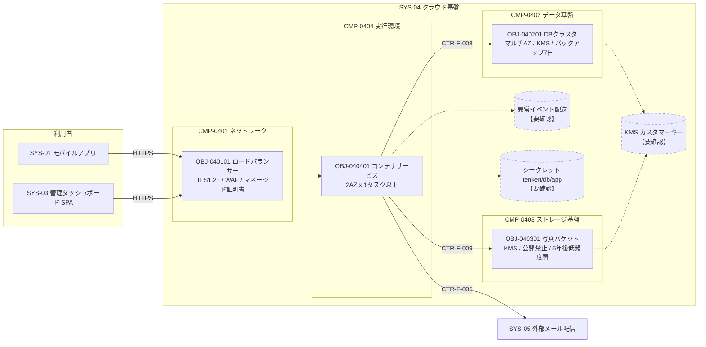

# 基盤設計書　SYS-04 クラウド基盤

| 項目 | 内容 |
|---|---|
| 対象システム | SYS-04 クラウド基盤（種別：基盤） |
| プロダクト | PRD-001 点検ノート |
| 版／状態 | 1／作成中（draft） |
| 作成日 | 2026-10-03 |
| 作成方法 | OKF バンドル（samples/tenken-note）から手書き。生成スクリプトは使用していない |
| 記法 | 【要確認：…】は OKF から読み取れなかった情報。候補を併記する場合は「候補」と明記し、決定値ではない |

## 改訂履歴

| 版 | 日付 | 内容 | 作成者 |
|---|---|---|---|
| 1 | 2026-10-03 | 初版 | 【要確認：OKF に作成者・承認者の情報がない】 |

---

## 1. 概要

### 1.1 目的

点検ノートのクラウド側（SYS-02 クラウドバックエンド、および SYS-03 管理ダッシュボード【要確認：後述 1.3】）を動かす基盤を、IaC で定義・管理する。

OKF 上の記載（SYS-04 本文）は「IaC で管理するネットワーク・実行環境。」のみ。実際の構成要素はデータ基盤・ストレージ基盤も含む（未決事項 U-01）。

### 1.2 前提

| 項目 | 内容 |
|---|---|
| クラウド事業者 | 【要確認：OKF に記載なし。用語（AZ、KMS、PutObject／GetObject、マネージド証明書）から AWS が想定されるが、明記されていない】 |
| リージョン | 【要確認：記載なし。候補：東京（ap-northeast-1）／大阪】 |
| IaC ツール | 【要確認：記載なし。候補：Terraform／AWS CDK／CloudFormation】 |
| IaC のリポジトリ・ステート管理 | 【要確認：記載なし】 |
| 環境 | 【要確認：本番のみか、検証・開発環境を持つか記載なし。環境ごとの差分（台数・バックアップ保持など）も不明】 |
| 命名規約・タグ規約 | 【要確認：記載なし】 |

### 1.3 対象範囲

| 対象 | OKF 上の根拠 | 備考 |
|---|---|---|
| 公開エンドポイント（ドメイン・LB・TLS 終端・WAF） | CMP-0401、OBJ-040101 | |
| 点検 DB の物理（DB クラスタ） | CMP-0402、OBJ-040201 | 論理（ER 図・テーブル）は SYS-02 の CMP-0204／CTR-F-003 |
| 写真の物理（バケット） | CMP-0403、OBJ-040301 | 論理（キー規約）は SYS-02 の CMP-0205／CTR-F-006 |
| コンテナ実行環境 | CMP-0404、OBJ-040401 | API・通知処理を動かす |
| 管理ダッシュボード（SPA）の配信 | なし | 【要確認：SYS-03 は SPA だが、静的ファイルの配信先（CDN／バケット／同じ LB）が SYS-04 のどこにも定義されていない。SPC-009 は「ダッシュボードが利用できる」ことを受入基準に含む】 |
| 異常イベントの配送基盤（キュー・再試行キュー・デッドレター） | なし | 【要確認：OBJ-020101 は「再試行キュー」、OBJ-020301 は「デッドレター」に言及するが、対応する IaC リソースがない】 |
| 認証基盤（点検者のログイン、管理者のログイン） | なし | 【要確認：SPC-001 の前提に「ログイン済み」とあるが、認証方式・IdP がどのシステムにも定義されていない】 |
| ネットワーク（VPC・サブネット・ルーティング・セキュリティグループ） | なし | 【要確認：マルチ AZ 構成の前提となる VPC／サブネットが定義されていない】 |
| 鍵管理（KMS カスタマーキー） | なし（設定値として言及のみ） | 【要確認：鍵自体のリソース定義・ローテーション・鍵ポリシーがない】 |
| シークレット（DB 認証情報 `tenken/db/app`） | CTR-F-008 で名前のみ | 【要確認：シークレットを作成するリソース、ローテーション方針がない】 |
| IAM ロール（「アプリのロール」） | CTR-F-009 で言及のみ | 【要確認：ロールの定義元リソースがない】 |
| DNS（公開ドメイン） | CMP-0401 本文で言及のみ | 【要確認：ドメイン名、ホストゾーンの管理がない】 |
| ログ・監視・アラート | なし | 【要確認：全面的に記載なし。8 章参照】 |
| コンテナイメージの保管（レジストリ） | なし | 【要確認】 |

---

## 2. 構成

### 2.1 コンポーネント構成

| コンポーネントID | 名称 | 種別 | 役割（OKF 本文） | 含む IaC リソース |
|---|---|---|---|---|
| CMP-0401 | ネットワーク | IaC | 公開ドメイン、ロードバランサー、TLS 終端、WAF | OBJ-040101 ロードバランサー定義 |
| CMP-0402 | データ基盤 | IaC | 点検 DB を載せる DB クラスタ | OBJ-040201 DBクラスタ定義 |
| CMP-0403 | ストレージ基盤 | IaC | 写真を置くバケット | OBJ-040301 写真バケット定義 |
| CMP-0404 | 実行環境 | IaC | API・通知処理を動かすコンテナ実行環境 | OBJ-040401 コンテナサービス定義 |

注：CMP-0401 の本文は「公開ドメイン」「WAF」を含むが、開発オブジェクトはロードバランサー定義 1 つのみ。ドメイン（DNS）と WAF の定義がロードバランサー定義に含まれるのか、別リソースなのかが不明（U-04）。

### 2.2 構成図

OKF に記載のある要素のみを実線、記載がなく存在が推定されるものを点線（【要確認】）で示す。

【要確認：ダッシュボード SPA が LB 経由で配信されるのか、別経路なのか不明。上図では API 呼び出し（CTR-F-004）のみ LB 経由として描いた】

### 2.3 ネットワーク

| 項目 | 値 | 出典 |
|---|---|---|
| 公開ドメイン名 | 【要確認：記載なし。メール送信元は `no-reply@tenken.example`（CTR-F-005）なので `tenken.example` 配下が候補】 | CMP-0401（言及のみ） |
| 公開プロトコル | HTTPS | OBJ-040101 |
| VPC CIDR | 【要確認】 | ― |
| サブネット構成（公開／非公開、AZ 数） | 【要確認：AZ 数は 2 と読める（OBJ-040401「2 つの AZ」）が、DB クラスタの AZ 数は「マルチ AZ」としか書かれていない】 | ― |
| インターネットへの出口（NAT 等） | 【要確認：通知処理は外部メール API（CTR-F-005）を呼ぶため外向き通信が必要】 | ― |
| セキュリティグループ／通信許可 | 【要確認：LB→コンテナ、コンテナ→DB（5432）、コンテナ→外部メール API の許可が必要と推定されるが記載なし】 | ― |

### 2.4 データ基盤

点検 DB（論理：CTR-F-003 点検DB、CMP-0204）の物理を担う。詳細は 3.2。

### 2.5 ストレージ基盤

写真（論理：CTR-F-006 写真ストレージ、CMP-0205）の物理を担う。詳細は 3.3。

### 2.6 実行環境

以下の開発オブジェクトのコンテナを動かす（CMP-0404 本文「API・通知処理」より）。

| 動かす対象 | 所属 | 備考 |
|---|---|---|
| OBJ-020101 点検結果登録API | SYS-02 / CMP-0201 | |
| OBJ-020102 点検写真登録API | SYS-02 / CMP-0201 | |
| OBJ-020201 拠点進捗取得API | SYS-02 / CMP-0202 | |
| OBJ-020301 異常通知処理 | SYS-02 / CMP-0203 | |

【要確認：上記をコンテナ何種類（サービス何個）に分けるかが記載なし。OBJ-040401 は「API と通知処理のコンテナを動かすサービス」と単数形で、1 サービスに同居させるのか、API と通知処理を別サービスにするのか不明】

【要確認：コンテナサービスとアプリの開発オブジェクトの対応は OKF のリレーションとして存在しない（デプロイ先の関係が表現されていない）。上表は CMP-0404 本文からの読み取り】

---

## 3. リソース設定値

### 3.1 OBJ-040101 ロードバランサー定義（CMP-0401 ネットワーク）

概要：公開ドメインへの HTTPS を受け、API コンテナへ振り分ける。

| 設定項目 | 設定値 | 出典／備考 |
|---|---|---|
| リソース種別 | 【要確認：ALB 等の具体種別の記載なし。候補：アプリケーションロードバランサー】 | |
| スキーム | インターネット向け（公開） | 「公開ドメインへの HTTPS を受け」より |
| リスナー | HTTPS 【要確認：ポート番号。候補：443】 | |
| HTTP（80）の扱い | 【要確認：拒否か HTTPS へリダイレクトか】 | |
| TLS ポリシー | TLS 1.2 以上のみ許可 | OBJ-040101、CTR-N-004 |
| 暗号スイート | 【要確認：ポリシー名の指定なし】 | |
| 証明書 | マネージド証明書を自動更新 | OBJ-040101 |
| 証明書の対象ドメイン | 【要確認】 | |
| WAF | マネージドルールセットを適用 | OBJ-040101 |
| WAF ルールセット名・除外ルール・レート制限 | 【要確認】 | |
| 振り分け先 | API コンテナ | OBJ-040101 |
| ルーティング規則 | 【要確認：`/inspections*`（CTR-F-001）と `/sites/*`（CTR-F-004）を同一ターゲットに送るのか、パスで分けるのか記載なし】 | |
| LB→コンテナ間の通信 | 【要確認：HTTP か HTTPS か。SPC-010「すべての通信が TLS 1.2 以上」を満たすには再暗号化が必要になる可能性がある（U-08）】 | |
| ヘルスチェック（パス・間隔・閾値） | 【要確認：OBJ-040401 の自動置き換えの前提だが値がない】 | |
| アイドルタイムアウト | 【要確認：写真アップロード（JPEG、長辺 2048px）の所要時間に影響】 | |
| リクエストサイズ上限 | 【要確認：写真 1 枚の最大バイト数が契約にない】 | |
| アクセスログ | 【要確認】 | |
| 冗長化 | 【要確認：AZ 数。CTR-N-003 の配分先に CMP-0401 がない（U-06）】 | |

### 3.2 OBJ-040201 DBクラスタ定義（CMP-0402 データ基盤）

概要：点検 DB を載せるマネージド DB クラスタ。

| 設定項目 | 設定値 | 出典／備考 |
|---|---|---|
| リソース種別 | マネージド DB クラスタ 【要確認：製品名の記載なし】 | OBJ-040201 |
| DB エンジン・バージョン | 【要確認：記載なし。CTR-F-008 のポート 5432 から PostgreSQL 系が推定されるが明記されていない】 | |
| インスタンスクラス | 【要確認：CTR-N-001 の集計クエリ 0.5 秒以内（拠点 100・設備 10,000・点検結果 10,000 件）を満たすサイズの根拠が必要】 | |
| インスタンス数（ライター／リーダー） | 【要確認】 | |
| 構成 | マルチ AZ 構成 | OBJ-040201、CTR-N-003 |
| フェイルオーバー | 自動フェイルオーバー | OBJ-040201、CTR-N-003 |
| フェイルオーバー所要時間の目標 | 【要確認】 | |
| データベース名 | `tenken` | CTR-F-008 |
| ポート | 5432 | CTR-F-008 |
| 保存時暗号化 | KMS カスタマーキー | OBJ-040201、CTR-N-004 |
| 通信の暗号化（アプリ→DB） | 【要確認：TLS 強制の有無の記載なし（SPC-010「すべての通信」）】 | |
| 自動バックアップ | 有効、保持 7 日 | OBJ-040201 |
| バックアップ時間帯 | 【要確認】 | |
| メンテナンス時間帯 | 【要確認：業務時間（平日 8〜20 時）外に置く必要があるが指定なし。候補：平日 20 時以降または土日】 | |
| 削除保護 | 【要確認】 | |
| 認証情報 | シークレット `tenken/db/app` に格納 | CTR-F-008 |
| 認証情報のローテーション | 【要確認】 | |
| パラメータグループ（文字コード・タイムゾーン等） | 【要確認：`inspectedAt`（date-time）、月次集計（当月の境界）に影響】 | |
| 配置サブネット | 【要確認：非公開サブネットが前提と思われるが記載なし】 | |
| 監視・ログ出力（スロークエリ等） | 【要確認】 | |

### 3.3 OBJ-040301 写真バケット定義（CMP-0403 ストレージ基盤）

概要：点検写真を保存するオブジェクトストレージのバケット。

| 設定項目 | 設定値 | 出典／備考 |
|---|---|---|
| バケット名 | 【要確認：名前の記載なし。アプリへは環境変数 `PHOTO_BUCKET` で渡す（CTR-F-009）】 | |
| 保存時暗号化 | KMS カスタマーキー | OBJ-040301、CTR-N-004 |
| パブリックアクセス | 全面禁止 | OBJ-040301 |
| アクセス許可 | アプリのロールに PutObject／GetObject のみ許可 | CTR-F-009 |
| TLS 以外のアクセス拒否 | 【要確認：SPC-010 の観点で必要と思われるが記載なし】 | |
| ライフサイクル | 5 年後に低頻度アクセス層へ移動 | OBJ-040301 |
| 削除（有効期限） | 【要確認：移動のみで削除の定めがない。写真の保存期間要件が要求・要件にない】 | |
| バージョニング | 【要確認：OBJ-020102 は「同じ n で再送された場合は上書き」とするため、上書き前の版を残すかどうかに影響】 | |
| バックアップ／レプリケーション | 【要確認：記載なし】 | |
| オブジェクトキー | `photos/{inspectionId}/{n}.jpg` | CTR-F-006（論理側の契約。物理の設定ではない） |
| アクセスログ | 【要確認】 | |

### 3.4 OBJ-040401 コンテナサービス定義（CMP-0404 実行環境）

概要：API と通知処理のコンテナを動かすサービス。

| 設定項目 | 設定値 | 出典／備考 |
|---|---|---|
| リソース種別 | コンテナサービス 【要確認：製品名の記載なし】 | |
| 配置 | 2 つの AZ にそれぞれ 1 タスク以上 | OBJ-040401、CTR-N-003 |
| 最小／最大タスク数 | 最小 2（各 AZ に 1 以上より）、最大【要確認】 | |
| オートスケーリング条件 | 【要確認】 | |
| タスクサイズ（CPU／メモリ） | 【要確認】 | |
| ヘルスチェック | 失敗時に自動で置き換え | OBJ-040401 |
| ヘルスチェックの判定条件 | 【要確認：パス・間隔・失敗回数】 | |
| 環境変数 | `DB_HOST`（CTR-F-008）、`PHOTO_BUCKET`（CTR-F-009） | 契約から |
| シークレット参照 | `tenken/db/app`（CTR-F-008） | 契約から |
| 外部メール API の認証情報 | 【要確認：CTR-F-005 に認証方式の記載がなく、どこに保管して注入するか不明】 | |
| タスクロール（「アプリのロール」） | PutObject／GetObject を写真バケットに許可 | CTR-F-009 |
| その他の権限 | 【要確認：KMS 復号、シークレット読み取り、キューへの送受信などが必要と推定】 | |
| デプロイ方式 | 【要確認：ローリング／ブルーグリーン等。業務時間中のリリース可否も不明】 | |
| ログ出力先・保持期間 | 【要確認】 | |
| コンテナイメージの取得元 | 【要確認】 | |

---

## 4. 依存関係

### 4.1 SYS-04 内のリソース間依存（構築順序）

OKF にはリソース間の依存関係のリレーションがない。以下は設定値から読み取れる範囲。

| 依存元 | 依存先 | 内容 | 根拠 |
|---|---|---|---|
| OBJ-040101 ロードバランサー | OBJ-040401 コンテナサービス | 振り分け先 | OBJ-040101 概要 |
| OBJ-040401 コンテナサービス | OBJ-040201 DBクラスタ | 接続先（`DB_HOST`、シークレット） | CTR-F-008 |
| OBJ-040401 コンテナサービス | OBJ-040301 写真バケット | 接続先（`PHOTO_BUCKET`、ロール） | CTR-F-009 |
| OBJ-040201／OBJ-040301 | KMS カスタマーキー | 保存時暗号化 | 【要確認：鍵リソースが未定義】 |
| 全リソース | VPC・サブネット | 配置 | 【要確認：未定義】 |

### 4.2 他システムからの依存（利用者）

| 提供する契約 | 利用する開発オブジェクト | 利用システム |
|---|---|---|
| CTR-F-008 DB接続（提供：CMP-0402） | OBJ-020101 点検結果登録API、OBJ-020102 点検写真登録API、OBJ-020201 拠点進捗取得API、OBJ-020301 異常通知処理 | SYS-02 |
| CTR-F-009 写真バケット（提供：CMP-0403） | OBJ-020102 点検写真登録API | SYS-02 |

注：CTR-F-009 は GetObject を許可しているが、写真を読み出す開発オブジェクトは存在しない（U-09）。

### 4.3 SYS-04 が依存するもの

| 相手 | 内容 | 状態 |
|---|---|---|
| SYS-05 外部メール配信（CTR-F-005） | 実行環境から外向き通信が必要 | 【要確認：接続先ホスト・許可方法の記載なし】 |
| コンテナイメージ（SYS-02 のビルド成果物） | 実行環境が動かすもの | 【要確認：受け渡し方法の記載なし】 |

---

## 5. 出力（他システムに提供する接続情報）

IaC が他システムへ提供する接続情報は、機能契約として定義されている（docs/concepts/contract.md「IaC が提供する機能契約」）。アプリはこの取り決めにのみ依存し、クラスタ・バケットの構成には依存しない。

| 出力 | 名前 | 値の渡し方 | 契約 | 備考 |
|---|---|---|---|---|
| DB エンドポイント | `DB_HOST` | 環境変数 | CTR-F-008 | 値（ホスト名）は IaC が生成 |
| DB ポート | 5432 | 固定値（契約で定める） | CTR-F-008 | 【要確認：環境変数で渡すのか、アプリに固定値で持たせるのか不明】 |
| DB 名 | `tenken` | 固定値（契約で定める） | CTR-F-008 | 同上 |
| DB 認証情報 | `tenken/db/app` | シークレット名 | CTR-F-008 | 【要確認：シークレットの中身の構造（キー名：username／password など）が定義されていない】 |
| 写真バケット名 | `PHOTO_BUCKET` | 環境変数 | CTR-F-009 | |
| 写真バケットへの権限 | PutObject／GetObject | アプリのロール | CTR-F-009 | 【要確認：ロール名・ロールを誰が作るか】 |
| 公開エンドポイント URL | 【要確認】 | 【要確認】 | なし | モバイルアプリ・ダッシュボードが接続する URL。SYS-01／SYS-03 に渡す契約がない。異常通知メール本文の「ダッシュボードの URL」（OBJ-020301）にも必要 |
| 異常イベントのキュー名等 | 【要確認】 | 【要確認】 | なし | 配送基盤自体が未定義 |
| 外部メール API の認証情報 | 【要確認】 | 【要確認】 | なし | |

【要確認：環境変数を注入するのは実行環境（CMP-0404）だが、契約の提供者はデータ基盤（CMP-0402）・ストレージ基盤（CMP-0403）。注入側の CMP-0404／OBJ-040401 と契約 CTR-F-008／009 の関係が OKF にない（U-05）】

---

## 6. 非機能

### 6.1 可用性（CTR-N-003 クラウド可用性）

| 項目 | 内容 | 出典 |
|---|---|---|
| 目標 | 平日 8〜20 時の月間稼働率 99.5% | CTR-N-003、SPC-009 |
| 受入基準 | 月次の稼働監視レポートで業務時間帯の稼働率 99.5% 以上。1 AZ 障害を模擬しても点検 API とダッシュボードが利用できる | SPC-009 |
| 配分：CMP-0404 実行環境 | 2 AZ に各 1 タスク以上、自動置き換え | CTR-N-003 |
| 配分：CMP-0402 データ基盤 | マルチ AZ・自動フェイルオーバー | CTR-N-003 |
| 配分：CMP-0401 ネットワーク | 配分なし 【要確認：LB・WAF も経路上の単一障害点になりうる】 | ― |
| 配分：CMP-0403 ストレージ基盤 | 配分なし 【要確認：写真アップロードが止まった場合に稼働率に含めるか】 | ― |
| 稼働率の測定方法 | 【要確認：外形監視の対象 URL、間隔、何をもって「停止」とするか】 | |
| 計画停止の扱い | 【要確認：業務時間外の計画停止を稼働率から除くか】 | |
| RTO／RPO | 【要確認：記載なし。バックアップ 7 日保持は世代数であり RPO ではない】 | |
| 災害対策（リージョン障害） | 【要確認：記載なし】 | |

### 6.2 セキュリティ（CTR-N-004 点検データ保護）

| 項目 | 内容 | 出典 |
|---|---|---|
| 目標 | 点検データを端末内・通信経路・クラウド上で暗号化する | CTR-N-004、SPC-010 |
| 通信経路（利用者→LB） | TLS 1.2 以上のみ許可 | CTR-N-004 配分（CMP-0401）、OBJ-040101 |
| 通信経路（LB→コンテナ、コンテナ→DB、コンテナ→バケット、コンテナ→外部メール） | 【要確認：配分なし。SPC-010 は「すべての通信が TLS 1.2 以上」】 | |
| DB 保存時暗号化 | KMS カスタマーキー | CTR-N-004 配分（CMP-0402）、OBJ-040201 |
| 写真 保存時暗号化 | KMS カスタマーキー | CTR-N-004 配分（CMP-0403）、OBJ-040301 |
| バックアップ・ログの暗号化 | 【要確認】 | |
| 鍵の管理者・ローテーション | 【要確認】 | |
| 公開範囲 | 写真バケットはパブリックアクセス全面禁止 | OBJ-040301 |
| WAF | マネージドルールセット | OBJ-040101 |
| 最小権限 | アプリのロールに PutObject／GetObject のみ | CTR-F-009 |
| 認証・認可（API 利用者） | 【要確認：CTR-F-001／004 に認証方式がない】 | |
| 監査ログ | 【要確認：記載なし。docs では監査ログも非機能契約（セキュリティ）で扱うとしているが、契約がない】 | |
| 個人情報 | 拠点テーブルに管理者メールアドレスを持つ（OBJ-020402） | 【要確認：個人情報の取り扱い方針の記載なし】 |

### 6.3 性能

SYS-04 への性能の配分は OKF にない。CTR-N-001（ダッシュボード 3 秒以内）の配分は CMP-0301・CMP-0202・テーブルのみで、ネットワーク（LB・WAF）の遅延に配分がない（U-07）。

### 6.4 バックアップ

| 対象 | 方式 | 保持 | 出典 |
|---|---|---|---|
| 点検 DB | 自動バックアップ | 7 日 | OBJ-040201 |
| 写真 | 【要確認：記載なし】 | ライフサイクル：5 年後に低頻度アクセス層（保存期限は不明） | OBJ-040301 |
| 長期保管（監査・法定保存） | 【要確認：点検記録の保存期間要件がない。写真は 5 年以上保持の想定に読めるが、DB は 7 日分のバックアップのみで整合が不明（U-10）】 | | |
| リストア手順・リストア試験 | 【要確認】 | | |

---

## 7. 運用

### 7.1 監視

OKF に監視の記載は一切ない。以下は項目のみ挙げ、値はすべて【要確認】とする。

| 監視対象 | 監視項目 | 閾値 | 根拠となる契約 |
|---|---|---|---|
| 公開エンドポイント | 外形監視（死活・応答時間） | 【要確認】 | CTR-N-003（稼働率の測定）、CTR-N-001 |
| ロードバランサー | 5xx 率、ターゲットの正常数 | 【要確認】 | CTR-N-003 |
| WAF | ブロック数 | 【要確認】 | ― |
| コンテナサービス | 稼働タスク数（AZ ごと）、CPU／メモリ | 【要確認：最低「各 AZ 1 タスク」を下回ったら検知】 | CTR-N-003 |
| DB クラスタ | フェイルオーバー発生、CPU、接続数、スロークエリ | 【要確認：集計クエリ 0.5 秒（CTR-N-001）を監視するか】 | CTR-N-001、CTR-N-003 |
| 写真バケット | 【要確認】 | 【要確認】 | ― |
| 異常イベント配送 | 再試行キュー滞留、デッドレター件数 | 【要確認】 | CTR-N-002（5 分以内） |
| 証明書 | 有効期限 | 【要確認：自動更新だが失敗検知の要否】 | ― |
| バックアップ | 成否 | 【要確認】 | ― |

### 7.2 アラート

| 項目 | 内容 |
|---|---|
| 通知先 | 【要確認】 |
| 通知手段 | 【要確認】 |
| 対応時間帯 | 【要確認：可用性目標は平日 8〜20 時。この時間外の障害対応要否が不明】 |
| 重要度区分 | 【要確認】 |
| エスカレーション | 【要確認】 |

### 7.3 運用作業

| 作業 | 内容 |
|---|---|
| 稼働率レポート | 月次で業務時間帯の稼働率を報告（SPC-009 受入基準）。作成者・作成方法は【要確認】 |
| 証明書更新 | マネージド証明書の自動更新（OBJ-040101） |
| パッチ適用・DB マイナーバージョン更新 | 【要確認】 |
| デッドレターの再処理 | 【要確認：OBJ-020301 がデッドレターへ送るとするが、その後の運用手順がない】 |
| IaC の変更手順（レビュー・適用） | 【要確認】 |

---

## 8. トレーサビリティ

| 要件 | 契約 | SYS-04 の受け手 |
|---|---|---|
| SPC-009 稼働率 99.5% | CTR-N-003 | CMP-0402（OBJ-040201）、CMP-0404（OBJ-040401） |
| SPC-010 暗号化 | CTR-N-004 | CMP-0401（OBJ-040101）、CMP-0402（OBJ-040201）、CMP-0403（OBJ-040301） |
| （なし） | CTR-F-008 DB接続 | CMP-0402 |
| （なし） | CTR-F-009 写真バケット | CMP-0403 |

注：CTR-F-008／009 を参照する要件はない。IaC の機能契約は要件から直接ではなく、論理側の契約（CTR-F-003／006）を通じて間接的に要件につながるが、その「論理契約 ↔ 物理契約」の関係は OKF に表現されていない（U-05）。

---

## 9. 未決事項

| No. | 内容 | 種類 | 関連 |
|---|---|---|---|
| U-01 | SYS-04 の本文は「ネットワーク・実行環境」とするが、データ基盤・ストレージ基盤も含む | 矛盾（記述の不足） | SYS-04 |
| U-02 | 異常イベントの配送基盤（キュー・再試行キュー・デッドレター）に対応する IaC リソースがない。OBJ-020101・OBJ-020301 が言及 | 抜け | CTR-F-007、CTR-N-002 |
| U-03 | 管理ダッシュボード（SPA）の配信基盤がない。SPC-009 は 1 AZ 障害時にダッシュボードが使えることを求める | 抜け | SYS-03、SPC-009 |
| U-04 | CMP-0401 本文の「公開ドメイン」「WAF」に対応する開発オブジェクトがない（ロードバランサー定義の設定に WAF が含まれるのみ） | 抜け | CMP-0401 |
| U-05 | CTR-F-008／009 の提供者はデータ基盤・ストレージ基盤だが、環境変数・ロールを実際に与えるのは実行環境（OBJ-040401）。また、論理契約（CTR-F-003 点検DB、CTR-F-006 写真ストレージ）と物理契約（CTR-F-008／009）の対応関係がリレーションにない | モデルの論点 | CTR-F-003/006/008/009 |
| U-06 | CTR-N-003 の配分に CMP-0401（LB）・CMP-0403 がない。SPC-009 の受入基準（1 AZ 障害で点検 API が使える）には LB の冗長化も必要 | 配分の抜け | CTR-N-003 |
| U-07 | CTR-N-001 の配分（描画 1.0＋API 1.5＋クエリ 0.5＝3.0 秒）で、クエリは API 応答時間の内側にあるため足し算すると二重計上になる。また LB・ネットワーク・WAF の遅延に配分がない | 矛盾 | CTR-N-001 |
| U-08 | SPC-010「すべての通信が TLS 1.2 以上」に対し、CTR-N-004 の配分は LB（CMP-0401）のみ。LB 以降（LB→コンテナ、コンテナ→DB、外部メール）の暗号化が未定 | 配分の抜け | CTR-N-004、SPC-010 |
| U-09 | CTR-F-009 は GetObject を許可し、SPC-004 は「写真が取得できる」を受入基準とするが、写真を取得する API（CTR-F-001 に GET なし）も利用者もない | 矛盾 | CTR-F-001、CTR-F-009、SPC-004 |
| U-10 | 写真は 5 年後に低頻度層へ移す（＝5 年超保持）が、DB のバックアップは 7 日のみ。点検データの保存期間要件が要求・要件にない | 根拠の抜け | OBJ-040201、OBJ-040301 |
| U-11 | KMS カスタマーキー、シークレット `tenken/db/app`、アプリのロール、VPC が設定値・契約で参照されるが、IaC リソース（開発オブジェクト）として定義されていない | 抜け | OBJ-0402/0403/0404 |
| U-12 | 監視・アラート・ログに関する要件・契約・リソースが一切ない。SPC-009 の「月次の稼働監視レポート」の作成手段もない | 抜け | SPC-009 |
| U-13 | 認証基盤（点検者・管理者のログイン）がどのシステムにもない | 抜け | SPC-001 |
| U-14 | クラウド事業者・リージョン・IaC ツール・環境構成が記載されていない | 抜け | SYS-04 |
| U-15 | 公開エンドポイント URL を SYS-01／SYS-03、異常通知メール（ダッシュボード URL）へ渡す契約がない | 抜け | OBJ-020301、CMP-0401 |
