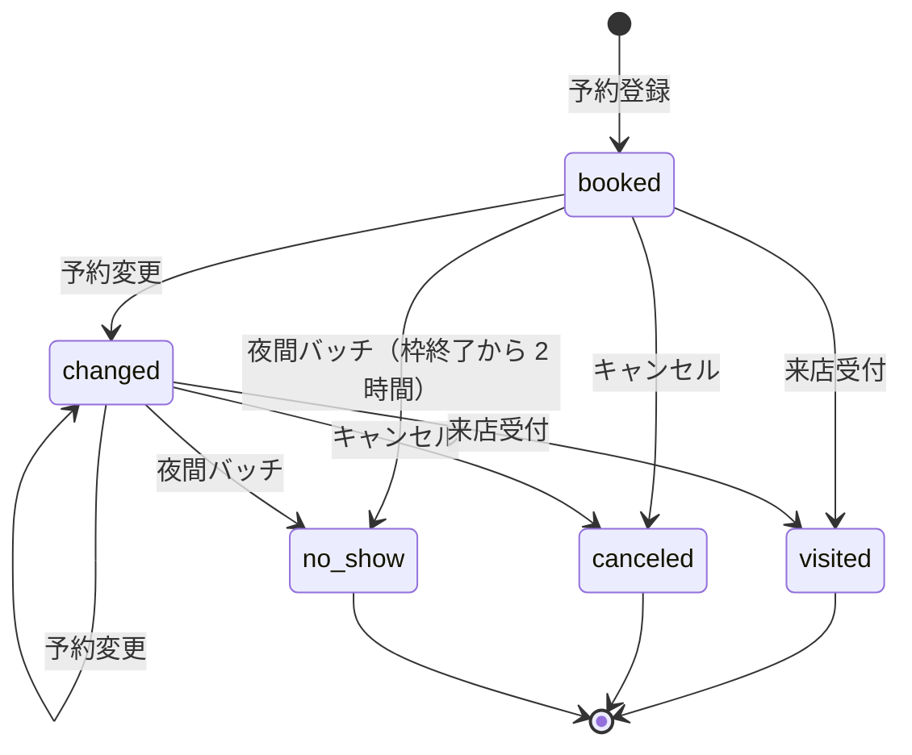

# OBJ-240101：予約テーブル

> 例：RDB のトランザクションテーブルの書き方。状態遷移、楽観ロック、パーティション、保持期間を本文に書く。エンティティ間の関連は契約の ER 図に任せる（題材：予約テーブル）

## 概要

1 行＝1 件の予約。予約枠に対して会員が予約し、来店・キャンセル・無断キャンセルで終わる。状態を変えるたびに予約履歴テーブルへ 1 行追加する（このテーブルは常に最新の状態だけを持つ）。

## 項目定義

共通項目（created_at、created_by、updated_at、updated_by）はシステムの共通方針どおり。

| 論理名 | 物理名 | 型 | 桁 | 必須 | キー | 既定値 | 説明 |
|---|---|---|---|---|---|---|---|
| 予約 ID | reservation_id | uuid | | ○ | PK | | アプリで採番（UUIDv7、時刻順） |
| 予約日 | reserved_date | date | | ○ | PK | | パーティションキー。枠の日付を写す |
| 予約番号 | reservation_no | char | 10 | ○ | UK | | 会員に見せる番号（R＋9 桁） |
| 会員 ID | member_id | bigint | | ○ | FK | | |
| 予約枠 ID | slot_id | bigint | | ○ | FK | | |
| 人数 | party_size | smallint | | ○ | | | 1〜8 |
| メニューコード | menu_code | varchar | 10 | ○ | | | |
| 連絡事項 | note | varchar | 200 | | | | |
| 状態 | status | varchar | 12 | ○ | | 'booked' | 状態値を参照 |
| リマインド要否 | remind | boolean | | ○ | | true | |
| 冪等キー | idempotency_key | uuid | | ○ | UK | | 予約登録の二重送信防止 |
| 版 | version | integer | | ○ | | 1 | 楽観ロック |

## インデックス・制約

| 名前 | 項目 | 種類 | 目的 |
|---|---|---|---|
| pk_reservation | reservation_id, reserved_date | 主キー | パーティションキーを含める必要がある |
| uk_reservation_no | reservation_no, reserved_date | 一意 | |
| uk_reservation_idem | idempotency_key, reserved_date | 一意 | 二重登録の防止 |
| ix_reservation_member | member_id, reserved_date desc | 通常 | マイページの予約一覧 |
| ix_reservation_slot | slot_id, status | 通常 | 枠の残席計算 |
| ck_party_size | party_size between 1 and 8 | チェック | |

パーティションをまたぐ一意は保証できないため、予約番号・冪等キーは予約日を含めた一意とする。冪等キーの照合は予約日を条件に含めて行う。

## 状態値・コード値

| 状態値 | 意味 |
|---|---|
| booked | 予約済み |
| changed | 変更済み（日時・人数を変更した） |
| visited | 来店済み |
| canceled | キャンセル（会員・店舗による） |
| no_show | 無断キャンセル |

状態遷移

- 上記以外の遷移は API で 409 を返す。終わった状態（visited・canceled・no_show）からは変えられない。
- 遷移のたびに予約履歴テーブルへ（予約 ID、旧状態、新状態、変更者、変更日時、理由）を同じトランザクションで追加する。

## 排他（楽観ロック）

- 更新は `where reservation_id = ? and reserved_date = ? and version = ?` で行い、version を 1 増やす。更新件数 0 なら 409（他の人が先に更新）を返す。
- 残席の確保は予約枠テーブルの行ロックで行う（予約DB の契約の取り決め）。予約テーブル自体は行ロックを使わない。

## パーティション

- reserved_date による月次のレンジパーティション（例：reservation_2026_10）。
- 3 か月先までのパーティションを月次バッチで事前に作る。予約は最大 60 日先までしか受けないため足りる。

## 件数見込み

| 初期 | 月次増分 | 累積（保持期間内） |
|---|---|---|
| 0 件（新規） | 約 90,000 件（300 店舗 × 300 件） | 約 330 万件（3 年） |

## 保持・削除

- 保持期間：予約日から 3 年。
- 月次バッチで 3 年を過ぎたパーティションを切り離し、集計用のアーカイブ（CSV、オブジェクトストレージ）へ書き出してから削除する。行単位の DELETE はしない。
- 予約履歴テーブルも同じ期間・同じ方法で削除する。
- 会員の退会時は、会員 ID を残したまま連絡事項を消す（個人情報の削除は会員テーブル側で行う）。
