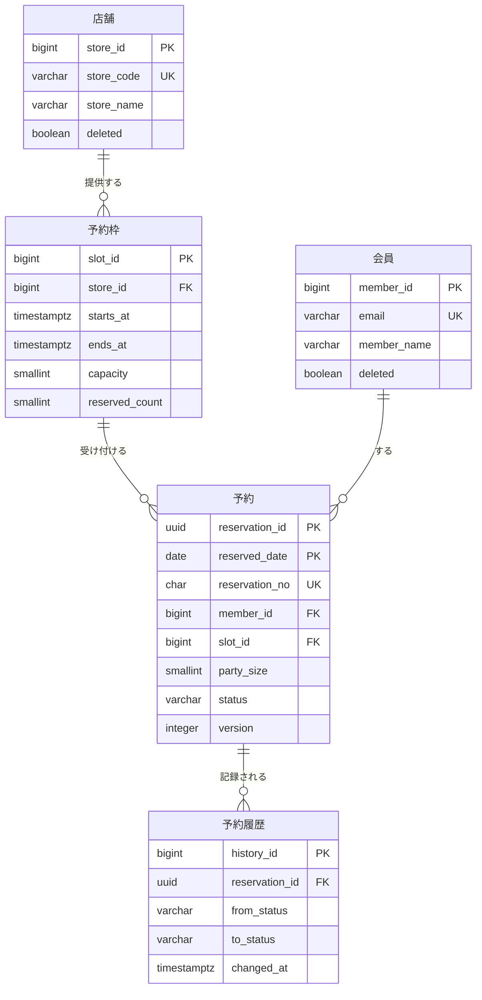

# CTR-F-202：予約DB

> 例：ER 図の契約の書き方。elements にエンティティを並べ、本文に DBMS の方針、ER 図、エンティティごとの主要項目、データ量を書く。物理定義（桁・インデックス・パーティション）はテーブルの開発オブジェクトに任せる（題材：予約DB）

予約システム（SYS-21）の予約API・管理画面API・夜間バッチ、および別システムの売上集計（SYS-24、読み取りのみ）から使われるため、システムをまたぐ厚い契約とする。

## DBMS・方針

| 項目 | 方針 |
|---|---|
| DBMS | PostgreSQL 16（マネージド。接続の取り決めは IaC が提供する DB 接続の契約） |
| マイグレーション | Flyway。スクリプトは予約API のリポジトリに置き、本番適用はリリース手順で行う。破壊的変更（列の削除・型変更）は 2 リリースに分ける |
| 文字コード・照合順序 | UTF-8、照合順序 `ja-x-icu` |
| 日時 | timestamptz で UTC 保存（表示の変換はシステムの共通方針） |
| 削除 | マスタ（店舗・会員）は論理削除、トランザクション（予約・予約履歴）は保持期間後にパーティション単位で物理削除 |
| 他システムからの参照 | 売上集計（SYS-24）は読み取り専用レプリカに、参照用ビュー `v_reservation_summary` だけを通して読む。テーブルを直接読まない |

## ER 図

## エンティティ

| エンティティ | 1 行の意味 | 主要項目と取り決め |
|---|---|---|
| 店舗 | 1 店舗 | store_code は他システムと共通のコード。営業時間は持たない（枠で表す） |
| 会員 | 1 会員 | 会員の正は会員システム（SYS-22）。ここは予約に必要な項目だけを日次で同期した写し。予約側からは更新しない |
| 予約枠 | 店舗の 1 時間帯 | capacity（定員）と reserved_count（予約済み人数）。**reserved_count の増減は予約の登録・変更・キャンセルと同じトランザクションで行い、予約枠の行ロックで排他する** |
| 予約 | 1 件の予約 | status は booked／changed／visited／canceled／no_show。version による楽観ロック。予約日（reserved_date）で月次パーティション |
| 予約履歴 | 予約の状態変更 1 回 | 予約の状態を変えるたびに同じトランザクションで追加する。更新・削除はしない（保持期間後の一括削除を除く） |

整合のルール

- 予約枠の reserved_count ＝ その枠の status が booked・changed の予約の party_size の合計。夜間バッチで検算し、ずれたら運用に通知する。
- 予約の reserved_date ＝ 予約枠の starts_at の日付（日本時間）。

## データ量・保存期間

| エンティティ | 初期 | 月次増分 | 保存期間 | 累積見込み |
|---|---|---|---|---|
| 店舗 | 300 | 数件 | 無期限 | 約 400 |
| 会員 | 50 万（移行） | 1 万 | 退会後 1 年 | 約 80 万 |
| 予約枠 | 0 | 約 10 万 | 3 年 | 約 360 万 |
| 予約 | 0 | 約 9 万 | 3 年 | 約 330 万 |
| 予約履歴 | 0 | 約 20 万 | 3 年 | 約 720 万 |

全体で 3 年後に約 15GB（インデックス込み）。
